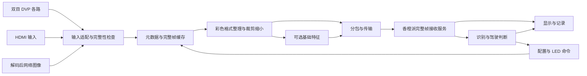

# FPGA_GSV1 开发准备与资料分析

> 版本说明（2026-10-20）：本文保留原始资料分析与当时的架构建议。当前固定输入映射、FPGA 三个主里程碑、香橙派协同道路理解和后续全景安排见 [FPGA优先开发方案V2](FPGA优先开发方案V2.md)。本文中“香橙派负责最终显示/全景”和旧 M0～M6 开发顺序不再作为最新实施路线。

分析日期：2026-10-20，Asia/Shanghai。

建议下一阶段从**一路干净彩色视频，经 FPGA 完整帧缓存后传到香橙派显示**开始。现有资料足以提供摄像头、DDR、HDMI、以太网的模块参考；仍需自行完成帧管理、图像传输协议、主机接收服务和真实识别闭环。新版本应按模块提取依赖，建立单独的源码清单与验收记录。

本报告是本轮准备工作的入口。原交接文档继续保存，用户已经确定的职责与顺序以其最新决定为准。本轮新增分析文档和索引，未开始 RTL、PDS 工程或香橙派应用开发。

## 1. 本轮分析的覆盖范围

| 对象 | 本次实际处理 | 分析边界 |
| --- | --- | --- |
| 指定交接文档 | 完整阅读，提取最新决定、历史状态和复用边界 | 历史构建及上板结论仍属于交接记录 |
| `资料` 全目录 | 6,919 个文件，8,668,617,647 字节，约 8.073 GiB；逐文件 SHA-256、类型及路径索引 | 文件数不含压缩包内部成员 |
| 内容去重 | 3,509 种不同文件内容 | 相同内容只分析一次，保留全部原始路径 |
| 散落 PDF | 128 个文件，按 SHA-256 去重为 99 份；全部提取文本 | 99 份合计 2,584 个物理页；提取成功不代表每页都完成人工精读 |
| Word | 2 份，读取正文及内嵌图资源 | 用于教程入口和连接座规则，未修改原件 |
| XLSX | 4 个文件、2 种内容，读取所有工作表的非空单元格 | 许可证申请模板和 PDS 告警参考；不是项目运行数据 |
| 压缩包 | 26 个，全部列举成员，共 5,069 条成员记录，包含目录项及重复包 | 源码参考包选择性解压到临时目录；未展开安装器内部实现或安装 IP |
| 包内 PDF | 额外读取 9 种散落文件中没有的内容 | PCIe 测试平台指南、MS7200/MS7210 软件手册、6 份厂商 IP 指南；加散落 PDF 共 108 种内容 |
| 文本源码、工程及日志 | 对原目录 2,281 种去重文本内容、解压参考包 1,222 个文本文件做机械扫描；重点追踪摄像头/缓存/UDP 顶层及约束 | 扫描含模块、配置和保护标记等；不等于逐行审计全部源码与生成模型 |
| 图纸与图片 | 渲染核对赛题关键页、双目原理图、低文本图纸；查看摄像头照片和联系方式图片 | 接线、机械制板仍需对照实物及原尺寸图纸 |
| CAD 原件 | 5 个，登记文件头/格式和用途 | DWG、PCB、SCH 未做原生电气与布线审查；DXF 未做机械尺寸签核 |
| 安装器、许可证、位流、数据库 | 全量登记与哈希；结合版本说明、发行说明、例程结构定位用途 | 未执行安装器、旧程序或位流；未改授权、网卡、系统设置 |

完整索引位于 `docs/preparation`：

- `materials_inventory.csv`：全部 6,919 个原始文件的路径、大小、扩展名、SHA-256 和自动类别。
- `documents_index.csv`：散落文档按内容去重后的提取状态及页数。
- `archive_members.csv`：26 个压缩包的成员索引。
- `资料阅读索引.md`：逐份文档用途、重复副本及压缩包处理说明。
- `review_summary.json`：本轮统计与覆盖边界，方便后续程序读取。

自动分类用于导航。例如 IP 目录中的 `.v` 可以被归入 IP，源码数量不能据此理解成全部手写 RTL 数量。旧 `docs/资料审查清单.md` 的 6,896 个文件、120 个 PDF 是此前快照，本轮重新统计结果不应覆盖或混写为当时结果。

## 2. 已经确定的项目基线

| 项目 | 后续开发采用的口径 |
| --- | --- |
| 工作目录 | `E:\zhoumian\FPGA\FPGA_GS\FPGA_GSV1` |
| FPGA | MES50HP / 盘古 50，PGL50H，-6、FBG484；手册完整料号为 PGL50H-6IFBG484 |
| ARM | 香橙派 5，16GB，RK3588S |
| FPGA 职责 | 视频接收、完整性检查、元数据、DDR、颜色整理、裁剪缩小、可选基础特征、传输及板上控制 |
| 香橙派职责 | 最终道路识别、跟踪与稳定、驾驶判断、全景标定融合、正常 HDMI 显示 |
| 主图与特征 | 干净彩色图是主数据；灰度、边缘等是与原图关联的辅助数据 |
| 调试屏 | FPGA 可选输出 MPI7001 800×480；不得将显示模式绑定成上传模式 |
| 上板方式 | 用户自己烧录、接线和反馈；AI 提供源码、检查结果和明确版本的文件 |
| 旧工程 | `E:\zhoumian\FPGA\old_GAP\FPGA drive\HDMI_DDR3_OV5640`，按模块参考与复用 |

### 2.1 新版本和历史版本的状态

本轮开始时，新目录只有交接文档，没有新版本 RTL、IP、PDS 工程或模型。本轮结束时新增的是本报告及其索引，1.0 实现状态仍为待开发。

以下仅继承交接记录，未在本轮重跑：V5.1 有用户确认的小屏稳定反馈；V5.2 已交付去诊断图案和显示提亮版本，但交接中尚无上板反馈。旧 V1～V5.2、v11/v12、S1/S2 的编号都不等于本项目的新 1.0。

实体 FPGA→香橙派视频上传、主工程双目并行、四路独立输入、模型实际部署、视觉驱动告警、U 盘文件往返 FPGA、真实全景融合，都没有足够证据标为已完成。

## 3. 赛题要求与工程对应

主依据是 `资料/紫光同创.pdf`，封面及页眉为 **2026**。ADAS 在物理第 14～16 页，对应印刷页码 12～14。本轮已逐页渲染核对这些页面。

| 原文要求 | 工程对应 | 验收时需要的证据 |
| --- | --- | --- |
| 图像采集、处理、LCD/HDMI 显示闭环 | FPGA 接收和处理，香橙派显示；FPGA HDMI 可用于定位问题 | 输入来源、图像规格、完整帧与连续显示记录 |
| MCU/FPGA 高速通信与指令交互，PCIe 只是举例 | 先验证千兆 UDP，同时保留按接口替换传输层的边界 | 实体链路吞吐、图像正确性、配置生效回读及异常恢复 |
| 基于 FPGA 的道路环境监测和特定场景感知 | FPGA 做明确的基础处理，香橙派完成高层识别和判断 | FPGA 实际承担的处理、资源与延迟，以及整体识别收益；单纯转发不能自动证明覆盖此项 |
| 至少四路视频并行采集和低延迟传输，高阶任务 | 单路验收后双路、四路；每路独立帧身份和统计 | 四个独立来源同时运行、每路 FPS、带宽和断流隔离 |
| 灰度、去噪、二值化、颜色空间转换等 | 第二阶段按需加入并提供旁路 | 同一输入前后对比、识别效果和耗时变化 |
| 十字路口红绿灯、强制闯红灯报警 | 识别服务、驾驶状态机、按键事件、LED/画面告警 | 基于当帧视觉的判断和可复现的操作记录 |
| 实线/虚线变道、强制实线变道报警 | 车道线识别和操作判断闭环 | 线型识别结果、左/右事件、告警、超时失效 |
| 带导航真实道路视频，另 1～2 个常见场景 | 后续明确导航信息获取方法及行人等场景 | 独立场景用例；不能只完成交通灯就宣称全部覆盖 |
| U 盘提供全部或 1～4 类现场场景 | 香橙派解码文件后送 FPGA，再取回处理结果；或经 HDMI 输入 FPGA | 陌生文件可加载，实际经过 FPGA；记录格式、帧率、尺寸适配 |
| 无明显时序违例，架构/数据流/资源/性能报告 | 每个里程碑保留可复现构建和最终报告 | 资源利用、时序、输入约束、CDC 说明、实测延迟 |
| 实物、完整源码、技术文档、1080P 且 3 分钟以内演示视频 | 从单路阶段持续保存证据，最后打包 | 固定源码版本、构建入口、位流哈希、复现实验步骤 |

赛题没有在这些页面给出一个可直接当验收线的统一 FPS、延迟毫秒数或识别准确率数值。项目可以设工程目标，但应标明是自定目标，并用实测说明。

处理器原文要求性能不高于 RK3568，与当前 RK3588S 方案存在差异。交接已记录用户接受此差异并继续制作作品，本报告沿用该决定，不更换处理器，也不把该选择写成官方批准。混合四路和双 FPGA 的评分认定也没有官方确认记录。

2023 年 PDF 仅用于历史技术参考：第一题是多媒体视频处理魔盒，网口用于输入叠加字符，第三题是 RISC-V 游戏机。它不能替代今年的 ADAS 任务与评测方式。

## 4. 硬件资源和资料中的板型区别

### 4.1 MES50HP 资源

下表依据硬件手册物理第 3～11、23～24、28～37 页及对应例程。引脚是手册与参考工程的静态依据，实际约束仍须对应用户底板版本。

| 资源 | 确认内容 | 对开发的影响 |
| --- | --- | --- |
| 逻辑 | 42,800 LUT6、64,200 FF、134 个 18 Kbit DRM、84 个 APM | 先留足 DDR、FIFO 和网络开销，再加入可选处理 |
| DDR | 两颗 4 Gbit，合计约 1 GiB，32 bit；手册列多种可替代料号 | 以板上实际颗粒和现有已适配 IP 为依据，不默认重新生成 |
| DDR 上限 | 400 MHz 时钟、800 MT/s，32 bit，理论 25.6 Gb/s = 3.2 GB/s | 这是引脚侧理论值，不是视频应用可持续带宽 |
| 时钟 | 50 MHz 系统、27 MHz 单端、125 MHz HSST 差分 | 50 MHz 手册引脚 P20；相机 PCLK、DDR、RGMII 是其他时钟域 |
| HDMI | 一路 MS7200 输入，一路 MS7210 输出 | 芯片支持上限不能当作当前配置和工程已实现规格 |
| 以太网 | 两个 RTL8211E/RGMII 物理端口 | 原厂只提供网口 1 演示；网口 2 需要独立适配与验收 |
| HSST | 芯片 4 lane，板上 2 路 SFP，另有 PCIe x2 | HSST 资源、SFP 和 PCIe 不能任意重复占用 |
| 扩展 J8 | 一个 40 针口，34 路普通 IO，另有电源和地 | 当前双目占用该扩展接口；不能直接分叉变四摄 |
| 按键/LED | 8 个用户键，按下低有效；8 个用户 LED，高有效 | 建立一次按下一个事件的消抖机制和明确灯号映射 |
| USB Type-C | CP2102 USB 转串口 | 适合日志和小控制，不能当 USB3 视频口 |

手册文件名含 `_1V1`，封面却写 V1.0、2024-07-19，图纸内也有更早板卡日期。后续应记录实物丝印、DDR 料号和关键器件；文件名本身不足以唯一确认硬件修订版。

### 4.2 容易混淆的资料

| 资料分支 | 实际对象 | 本项目处理方式 |
| --- | --- | --- |
| `盘古50K开发板/` | 当前 MES50HP 通用底板与例程 | 首选硬件、DDR、HDMI、网口、按键参考 |
| `MES50H-HDMI视频板/` | 同类核心板，专用三 HDMI 输入底板 | 借鉴芯片配置；引脚、IIC 总线和初始化顺序单独核对 |
| `MES50HP-网口板/` | YT8614，多网口，经 QSGMII/HSST 接入 | 不能替代 MES50HP 的 RTL8211E/RGMII 驱动和约束 |
| `OV5640.../实验例程2-基于PGX-NANO/` | 640×480@60、VGA、行缓存参考 | 不是当前 720P DDR HDMI 工程 |
| `OV5640.../实验例程4-基于100Pro+/` | 100Pro+/200Pro+、FMC 转接板 | 仅借鉴模组接口，不能照搬器件、管脚、IP |
| `PCIE资料/pcie_test_platform...zip` | Linux 驱动、应用与 PG2L100H 等测试 RTL | 可以参考 DMA/驱动思路；需要 PGL50H、ARM64、内核与物理接入适配 |
| ADDA、SPI TFT、OLED、音频模块、VGA | 教学与其他外设扩展 | 留作可选展示，不进入首个视频闭环的必要依赖 |

HDMI 专用底板的演示是按键选择三路中的一路直通输出，没有三路独立完整帧缓存和并行上传。网口专用底板的八口/光纤回环也不是现成的视频采集系统。

## 5. 从实际源码核实的关键细节

### 5.1 原厂摄像头例程只发布一路

以下三个原始包内容相同，SHA-256 为 `b056118f39c188f03d8fb8d868fa111bb2acc6b67e068e16111bfb0949f9fef5`：

- `资料/OV5640双目摄像头资料/实验例程1-基于盘古50K/HDMI_DDR3_OV5640_test(1).rar`
- 同目录 `HDMI_DDR3_OV5640_test.rar`
- `资料/盘古50K开发板资料/盘古50K开发板/2_Demo/10_HDMI_DDR3_OV5640_test.rar`

包内顶层为 `10_HDMI_DDR3_OV5640_test/source/rtl/hdmi_ddr_ov5640_top.v`。第 21～23 行宏定义选择 CMOS1；第 189、201 行有两路配置实例，第 220、239 行有两路字节拼接实例，但第 251～261 行的 `ifdef/elsif` 仅选择一路 `pclk/vsync/de/rgb565`，再在第 264 行接入一个 `fram_buf`。

这证明左右接口的基础接收代码存在，也证明默认后级仍是单路。双路阶段需要分别接收、跨时钟、缓存、编号、排队和调度，不能仅同时打开两个宏。

### 5.2 RGB565 的色序有明确原因

包内 `reg_config.v` 第 163～164 行设置：

```verilog
0x4300 = 0x60;
0x501F = 0x01;
```

OV5640 数据手册物理第 74、87 页说明：`0x501F=1` 选择 ISP RGB；`0x4300=0x60` 选择 RGB565，两个字节的顺序为 `{b[4:0],g[5:3]}`、`{g[2:0],r[4:0]}`。拼成 16 bit 后蓝在高位、红在低位，因而顶层交换 `[4:0]` 与 `[15:11]`，形成内部常用的 R[15:11]、G[10:5]、B[4:0]。

这也纠正了摄像头实验说明物理第 3 页“两个 RAW 像素合成”的说法：本配置接收的是 **8 bit DVP 上连续两个字节组成一个 RGB565 像素**，不是两个 Bayer RAW 像素，当前路径不需要据此加入去马赛克。

新协议要分别规定颜色位段和传输字节序。若改为 `0x4300=0x61`，原有红蓝交换就不能无条件保留。先用纯红、纯绿、纯蓝、灰阶验证相机寄存器、DDR、UDP 解包和 Linux 显示全链路，避免多处同时交换。

### 5.3 DDR 是简化 AXI，不能照标准 AXI 假设改线

原厂 `fram_buf.v` 默认 H_NUM=1280、V_NUM=720、PIX_WIDTH=16；外部 DDR 为 32 bit，IP 用户数据口为 256 bit。其写末拍来自 `axi_wusero_last`，方向为 IP 输出，和标准 AXI 的主设备 WLAST 输出不同。

额外在 `system_ip_lite.zip` 中发现的 `UG022003_Logos_HMIC_S_IP.pdf`，物理第 25～33 页给出相同接口：写数据通道没有标准 WVALID/B 响应组合，读数据通道也没有标准 RREADY 背压接口；`axi_wready` 指示写数据传输，`axi_wusero_last` 指示末拍。第 48～50 页说明 burst、时钟、IO 和布线约束。

因此，在适配层内部按厂商协议完成读写；对外再提供明确的帧读写接口。读出命令发出前应保证 FIFO 能接住整个返回 burst，不能等返回时再依靠不存在的 RREADY 阻塞。新帧发布必须等待预期数据落地，不能把下一次 VSYNC 到来直接当作 DDR 写完。

旧工程已有末拍握手、末行缺失、帧所有权的修复记录。选择旧工程实现时，应同时提取对应测试和依赖，避免退回未修复原厂版本。本轮没有重新验证这些历史修复。

### 5.4 原厂以太网提供分层起点，缺少视频应用层

`11_ethernet_test.rar` 内含 RGMII、MAC、ARP、IP、UDP、ICMP、CRC 模块。顶层默认：板 IP 192.168.1.11、目标 192.168.1.105、UDP 端口 `0x1F90` 即 8080。这些是参考工程常量，后续不能自动修改用户电脑配置来套用。

`source/eth_udp_test.v` 第 216～228、247～275 行附近发送固定的 20 字节测试字符串，并用等待计数器周期发送。现有 app_data 接口可以作为接入点，但不是持续摄像头数据通道。

需要新增 DDR 读调度、分包头、包内长度、帧身份、帧结束校验、发送节奏与丢帧统计。接收方向还需配置命令解析与 ACK，文件输入阶段再加入图像分片接收和完整帧提交。

`ethernet_test.fdc` 的有效引脚对应网口 1，网口 2 约束被注释；例程说明物理第 21 页也明确“目前只提供 Ethernet1 的实验例程”。该包不能据此宣称双网口同时工作。

还需在实际集成时检查 RGMII 收发时钟/相位关系、PHY 延时设置、跨域和完整外部时序约束。例程代码中存在隐式网络和历史注释痕迹；按可复用候选对待，不把历史生成位流当作新链路通过证据。

### 5.5 HDMI 配置、采集和调试显示分开

MS7200 是接收，MS7210 是发送。标准 MES50HP 手册给出 IIC 地址 0x56、0xB2；移植到软件 I2C API 时应先确认使用 7 bit 地址还是包含 R/W 位的地址字节，不能直接混用。

原厂 HDMI 环路示例为 1920×1080@60、RGB888，并要求输入规格匹配；摄像头示例为 1280×720@30、RGB565；当前小屏则采用历史 800×480 时序。三组规格分别属于不同模块边界。

HDMI 的接入需要检测锁定、有效像素尺寸和断流；若源分辨率改变，应丢弃半帧并重新建立规格。MS7200/MS7210 软件开发手册还提供时钟、Timing、EDID/HPD 状态接口线索，可在需要兼容更多视频源时查询。

MPI7001 调试显示可参考交接中的 992×497 总时序、约 29.545454 MHz 像素时钟、+HS/−VS。该参数的稳定依据来自旧 V5.1 用户反馈，不能代替新工程上板验收。9/8 提亮只属于显示出口处理，默认不改模型输入主图。

## 6. 可复用资产与需要新做的部分

| 模块 | 推荐参考入口 | 复用方式 | 新版本仍需完成 |
| --- | --- | --- | --- |
| OV5640 上电、I2C、寄存器 | 原厂摄像头包、旧工程稳定采集版本 | 保留寄存器表来源和色序说明 | ACK/失败可观测、规格验证、断流/重启恢复 |
| DVP 采集、8→16 bit | 原厂 `cmos_8_16bit`，旧工程采集状态模块 | 保留 Pango 时钟原语依赖，单独封装 | 行/帧计数、奇数字节/坏帧处理、跨域 |
| DDR PHY/IP | 已适配 MES50HP 的厂商生成文件 | 固定器件/版本/颗粒/引脚，登记许可来源 | 新框架适配、容量/地址单位/边界验证 |
| 帧缓存控制 | 旧工程完整帧与所有权修复版本 | 源码和对应测试成组提取 | 多消费者、网络背压、每通道缓冲管理 |
| MS7200/7210 | MES50HP 原厂配置、旧显示版本 | 区分接收与发送 | 输入状态检查及可选调试出口 |
| 网口 | MES50HP `11_ethernet_test` | 参考分层和 Pango RGMII 原语 | 图像协议、持续吞吐、配置收发、异常恢复 |
| ROI/缩小 | 旧模块和外部开源仅作候选 | 先写清坐标/采样/边界定义 | 与完整帧和配置版本关联、参考模型对比 |
| 灰度/滤波/Sobel/阈值 | 旧图像处理模块 | 逐个独立封装并支持旁路 | 延迟对齐、边界策略、效果与成本测量 |
| 按键/LED | 原厂键控例程、旧 KEY8 事件机制 | 复用消抖思想和实际极性 | 事件编号、重发去重、告警超时 |
| 香橙派服务 | 历史主机协议工具只作方法参考 | 重新按视频协议组织 | 收帧、分发、识别、驾驶判断、显示、日志 |

以下不进入默认首版：FPGA 整网推理、旧启发式最终道路判断、旧 HUD 轮播、人工 TTC/距离效果、识别框回传 FPGA 绘制、全景几何融合、双 FPGA 互连。其历史文件保留在原目录，按后续明确需求取用。

外部 GitHub 仓库沿用交接中“参考案例”的定位，本轮未在线重新审查或下载。正式采用模块时，再记录准确提交版本、许可证和修改点。

## 7. 建议的数据结构与模块边界

下述为准备阶段建议，尚未冻结为协议或实现。



### 7.1 统一帧描述

每帧至少有：协议版本、设备/会话身份、通道号、流类型、帧号、采集时间、宽高、格式、stride、总有效长度、配置版本、完整性状态。特征流额外带原帧身份、ROI 原点及尺寸、缩放映射。

帧号应在采集侧分配并允许出现缺口；主动丢帧、坏帧丢弃、网络丢帧分开计数。会话标识用于区分重启前后的同名帧号。采集时间建议定义为输入 SOF 对应的单调计数值，并公布频率；它不天然等于曝光时刻或 Linux 时间。

### 7.2 帧缓冲所有权

建议采用明确状态，例如空闲→写入→完整提交→被消费者持有→释放。写端不能覆盖正在发送或显示的帧；坏帧、断流中断的帧不能发布。多个消费者应有持有计数或等价机制，显示和网络均释放后才允许复用。

三缓冲是便于解耦的一种候选，需要按实际调度决定。缓冲耗尽时允许按策略丢完整帧并计数；不能把半帧与下一帧拼接，也不能为保留所有旧帧导致延迟无限增长。

### 7.3 配置在帧边界生效

ROI、输出尺寸、特征开关和发送 FPS 应先做合法性检查，再在帧边界提交；ACK 返回请求编号、实际配置值和生效帧/配置版本。消费者根据帧元数据解释新尺寸，不依靠启动时写死的宽高。

按键事件带事件编号和时间；LED 命令带命令编号、有效期和应用结果。重发不能重复执行一次驾驶请求。识别过期、心跳消失、视频断流都要进入“无法判断/输入失效”状态，不延用上一帧的允许操作结论。

### 7.4 UDP 图像应用层

按常规 IPv4、无 IP 选项、MTU=1500 计算，UDP 应用数据上限为 1472 字节。若应用头暂按 48 字节，则像素分片最多 1424 字节；实际头长度冻结后重算。推荐应用层分片，避免依赖 IP 分片或一开始要求全链路巨帧。

头部需要明确多字节整数端序、像素字节序、分片号/偏移、有效长度和总帧长度。接收方按设备/会话/通道/帧建立重组状态，检查重复、重叠、越界、乱序、缺片及超时。只有完整且校验通过的帧进入共享接收队列。

以 1424 像素字节为例，一帧 720P RGB565 的 1,843,200 字节约需 1295 个包，30 fps 约 38,850 包/秒。每包写日志或频繁复制整帧可能形成 Linux 侧瓶颈，应通过实测优化接收批处理、队列和显示节奏。

实时预览可优先丢弃超时帧、处理最新完整帧；文件输入若要求确定性逐帧往返，应另设窗口/确认或重传策略，不能把实时丢帧策略直接当无损文件传输。

## 8. 带宽与缓存预算

计算均为未压缩有效像素，不含协议、帧间隙、特征图或重传；不是实测结果。RGB565 按 2 字节/像素，灰度按 1 字节/像素。

| 输入/输出规格 | 每帧字节 | 30 fps 单向像素带宽 |
| --- | ---: | ---: |
| 一路 1280×720 RGB565 | 1,843,200 | 442.368 Mb/s |
| 双路 1280×720 RGB565 | 3,686,400 | 884.736 Mb/s |
| 四路 1280×720 RGB565 | 7,372,800 | 1769.472 Mb/s |
| 一路 640×360 RGB565 | 460,800 | 110.592 Mb/s |
| 四路 640×360 RGB565 | 1,843,200 | 442.368 Mb/s |
| 四路 640×360 灰度辅助流 | 921,600 | 221.184 Mb/s |

单路 720P RGB565 30 fps 适合用作首版千兆验证目标；实际可持续帧率须以有效吞吐和主机处理能力验收。双路同规格已占单千兆大部分容量，余量明显变少；四路同规格超过单千兆，必须缩小、降帧、改变接口或采用其他经验证的策略。

四路 640×360 RGB565 30 fps 加四路同尺寸 8 bit 特征图，像素载荷为 663.552 Mb/s。不能默认每种特征都上传。四路彩色降为 15 fps 则为 221.184 Mb/s，是后续可比较的配置。

一帧 720P RGB565 约 1.758 MiB，四路各三缓冲的纯像素空间约 21.094 MiB，另加对齐和辅助流。DDR 容量足够容纳这类帧缓冲，但吞吐、仲裁、外部时序和正确性仍需验证。四路 720P30 若各写一次、读一次，仅像素内存流量约 442.368 MB/s；再给显示、缩放或特征处理增加读写时需继续累加。

千兆全双工是两个方向分别具有 1 Gb/s 链路上限。文件像素送入 FPGA 再返回时要分别计算两个方向，并考虑双方缓存和处理负担；两个方向不能合并成单向 2 Gb/s。两块 FPGA 经交换机汇总也受香橙派实际接收口限制。

## 9. 后续开发顺序与验收门槛

阶段名称是本报告的建议编号，与旧版本编号独立。FPS、测试时长等未写成官方规则。

| 阶段 | 交付范围 | 进入下一阶段前的验收 |
| --- | --- | --- |
| M0 构建与接口准备 | 实物信息表、器件/IP/源码清单、时钟复位表、帧/通信协议草案、唯一构建入口 | 目标器件和工具匹配，必要依赖齐全；最小链路诊断可说明收发、CRC、包序和恢复 |
| M1 单路彩色主链路 | CMOS1→DDR 完整帧→图像分包→香橙派共享收帧服务→正常显示 | 首末像素与行数正确；色序正确；帧身份与统计正确；断流/重启可恢复；具备有效吞吐实测 |
| M2 ROI 与缩小 | 可配置裁剪、缩小及帧边界提交 | 坐标映射可还原；奇偶尺寸、边界 ROI 和配置切换有参考结果；错误参数有明确返回 |
| M3 单路识别与判断 | 红绿灯、车道及实虚线，按键→判断→LED/画面闭环 | 使用实际输入；有置信度/有效期；不确定时输出无法判断；保存成功和失败用例 |
| M4 FPGA 基础特征 | 灰度、一种滤波、Sobel、阈值，逐项可旁路 | 与参考模型对齐；记录资源、延迟和识别收益；彩色主图始终可用 |
| M5 双路再四路 | 每路独立采集缓存与调度，混合输入按真实来源登记 | 同时运行、通道不串帧；每路 FPS/带宽可观测；单路断流不拖垮其他路；跨板时基如实说明 |
| M6 场景扩展与全景 | U 盘测试完整路径、导航、行人/斑马线等，再做标定融合 | 陌生场景可加载；标定与时间对应有依据；资源/时序/性能和演示材料齐全 |

U 盘输入协议和解码入口应在 M0 预留，在 M1 接收服务形成后尽早做样例验证；表中 M6 表示完整场景验收，不能等全部硬件开发结束才发现现场文件无法送进 FPGA。若早期以 HDMI 导入文件，明确视频输出设备和香橙派最终显示连接关系，避免隐含缺少物理视频源。

第一条主链路优先保持已经有参考的 1280×720 RGB565，避免把缩放正确性也塞进首个采集验收。受实际链路制约时可以降低发送 FPS；640×360 上传应在 M2 缩小验收后启用，不把低分辨率预览冒充原始分辨率。

### 9.1 最小但有意义的验证集

1. **像素正确性**：纯色、棋盘和像素坐标编码图；核对首行、末行、首末像素、整帧 CRC。测试源必须有明确标记。
2. **帧所有权**：写端/显示/发送速度不同，连续背压，缓冲耗尽；验证不覆盖持有帧，丢帧有统计。
3. **DDR 返回间隙**：burst 中间和最后一拍前插入空隙，结合厂商接口检查完成条件与末行完整性。
4. **传输异常**：缺片、重复、乱序、越界长度、旧会话包、主机重启；不完整帧不显示为完整。
5. **配置与恢复**：ROI/尺寸切换、无输入、相机重启、链路恢复；新配置只作用于完整的新帧。
6. **驾驶闭环**：红/绿灯、虚/实线左右变道、识别超时、失联；操作请求和实际视觉结果可追溯。

每次交付区分：代码存在、接入顶层、仿真、综合、布局布线、时序、生成位流、用户烧录、现场功能通过。不要合并成一个“完成”。

## 10. 工具链准备结论

本轮只做存在性核对，确认以下位置存在：

```text
PDS：E:\XUEXI\FPGA_PDS\PDS_2022.2-SP6.4
Icarus：E:\zhoumian\FPGA\tmp\v5_tools\ucrt64\bin\iverilog.exe
旧构建入口：E:\zhoumian\FPGA\old_GAP\FPGA drive\HDMI_DDR3_OV5640\impl.pds
```

存在不代表当前授权、仿真库或新工程构建已经通过。本轮没有启动综合、仿真、布局布线、下载工具或板卡连接。

原厂摄像头包的 `.pds` 为旧 2022.1 工具生成、工程格式 1.0.8；交接中旧工程又出现过不同格式号问题。新工程应使用当前选定工具建立明确入口，并按依赖引用源码和 IP；不能只改工程格式/版本号便宣称兼容。

PDS 资料同时含完整 SP6.4 和 SP1-Lite。Lite 发行说明物理第 7 页明确是免 license **试用 1095 天**，不是永久无期限；第 4、7 页列 TA、部分功耗及其他组件不支持/限制。不能因为目录叫“免 License”就认为它能无条件替代当前工具，也不能依据 2023 年发行日期推断本机试用何时到期。

教程引用的 `6_IP_setup_packet` 不是当前 MES50HP 资料目录中的同名现成目录，但参考工程含已生成 IP，`system_ip_lite.zip` 含 HMIC/HSST/PCIe 等 `.iar` 和用户指南。需要区分“已生成可引用”“有原始安装包”“已安装可重新生成”“当前许可可用”四种状态；本轮没有安装或替换它们。

PDS 与 ModelSim 的授权分别确认。Pango 原语/IP 仿真需匹配厂商库；Icarus 可验证自写控制和参考模型，不能把临时兼容模型结果当作厂商 PHY 全部行为通过。

## 11. 开工时应补齐的信息

这些是后续阶段的输入清单，不阻止本轮资料分析，也不需要为了准备工作立即购买器件。

| 项目 | 当前已知 | 在哪一步补齐 |
| --- | --- | --- |
| 板卡丝印和 DDR 料号 | MES50HP、手册列多种 DDR | M0 固定板级约束前 |
| 首次链路接收端 | 最终为香橙派 5，可先用 PC 验证同一接收协议 | M0/M1 开始实体链路前 |
| 香橙派系统、内核、网口和运行库 | 交接未给出可复现环境清单 | M1 收帧部署；M3 再确认 RKNN/模型运行时 |
| 模型、数据集和评价方法 | 没有已部署完成的证据 | M3，按交通灯、车道、线型分别验证 |
| 四路来源和物理布置 | 双目左右+HDMI+网络是候选 | M5 前，单独说明独立来源与全景视角条件 |
| 现场文件格式 | 只知道 U 盘场景，不知道最终编码/分辨率 | 协议先支持规格描述，尽早准备多种文件样例 |
| 性能目标和比赛时间节点 | 资料未给项目工期与统一数值门槛 | 按实际测试确定目标和优先级，不编造截止日期 |

## 12. 建议的新工程组织

以下结构供下一阶段采用，本轮没有建立其中的 RTL、软件或构建文件：

```text
FPGA_GSV1/
  docs/                    架构、协议、需求、验收和本轮资料分析
  rtl/
    board/                 MES50HP 顶层、时钟复位与板级接口
    capture/               DVP、HDMI、网络像素接收
    frame/                 元数据、完整帧、所有权与 DDR 调度
    image/                 格式、ROI、缩小、可选基础特征
    transport/             图像分包、命令、状态与事件
  vendor/                  明确版本的原厂 IP 和来源说明
  constraints/mes50hp/      物理和时序约束
  sim/                     有必要的控制与图像参考用例
  host/                    一个共享收帧服务及其显示/识别消费者
  scripts/                 唯一可复现构建与检查入口
  reports/                 每次构建和阶段验收证据
```

生成目录、旧位流、安装包和试验脚本不放入正式源码清单。每个复用模块记录原路径、原版本/哈希、修改点、许可来源及验证状态。调试模式明确开关，正常上传始终保持干净彩色主图。

## 13. 关键资料定位

原始路径均以 `E:\zhoumian\FPGA` 为根，页码使用 PDF 物理页码。

| 资料 | 重点定位 |
| --- | --- |
| `FPGA_GS/FPGA_GSV1/当前对话整理与FPGA_GSV1开发交接.md` | 第 3～6 节职责/顺序/带宽；第 9～12 节旧成果与协作边界 |
| `资料/紫光同创.pdf` | 第 14～16 页，当前赛题主依据 |
| `资料/2023年紫光同创选题指南.pdf` | 第 1～3 页，历史任务比较 |
| `资料/盘古50K开发板资料/盘古50K开发板/3_Hardware/MES50HP开发板硬件使用手册_1V1.pdf` | 第 8 页资源，第 10～12 页 DDR，第 23～24 页网口，第 28～32 页 HDMI，第 33～37 页按键/LED/扩展 |
| `资料/OV5640双目摄像头资料/实验例程1-基于盘古50K/OV5640双目摄像头实验例程v1.pdf` | 第 2～6 页规格、路径与二选一输入 |
| `资料/OV5640双目摄像头资料/芯片数据/OV5640_DataSheet.pdf` | 第 74 页 ISP 格式；第 86～87 页输出格式和 RGB565 字节序 |
| `资料/盘古50K开发板资料/盘古50K开发板/1_Demo_document/实验例程说明篇/11_以太网传输实验例程说明v1.pdf` | 第 18～21 页 ARP/CRC/连接及只提供网口 1 的说明 |
| 同目录 `5_6_HDMI实验例程说明v2.pdf` | 第 5～7 页，1080P60 配置与环路 |
| 同目录 `7_DDR读写实验例程说明v1.pdf` | 第 1～2、7～9 页，DDR IP、示例与指示信号 |
| `资料/PDS 安装包/PDS 安装包 免License/system_ip_lite.zip` | 包内 `UG022003_Logos_HMIC_S_IP.pdf` 第 25～33、48～50 页；另含 HSST/PCIe/SGMII/XAUI/QSGMII 指南 |
| `资料/盘古50K开发板资料/盘古50K开发板/4_IC_datasheet/HDMI PHY/2023.03.13 MS7200寄存器配置说明.7z` | 包内 MS7200 软件手册，输入状态、时钟和 Timing/HPD/EDID |
| 同目录 `2023.03.13 MS7210寄存器配置说明.7z` | 包内 MS7210 软件手册，输出配置、HPD/EDID |
| `资料/盘古50K开发板资料/盘古50K开发板/3_Hardware/核心板连接座/先读我！重要说明.docx` | PADS 9.5+、80 pin、0.5 mm 间距、4.5 mm 合高母座及连接编号/固定坐标要求 |

逐份文档和全部副本路径请查 `preparation/资料阅读索引.md` 和 CSV，不需要再次按文件名猜测哪份是重复资料。
