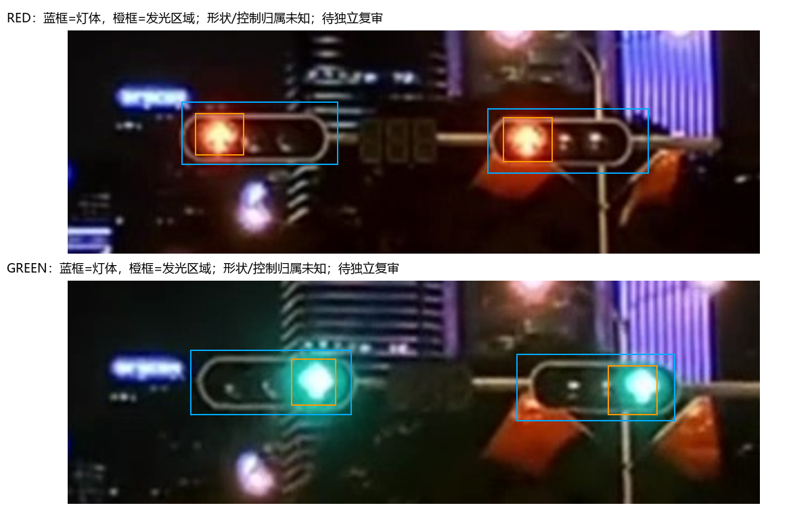
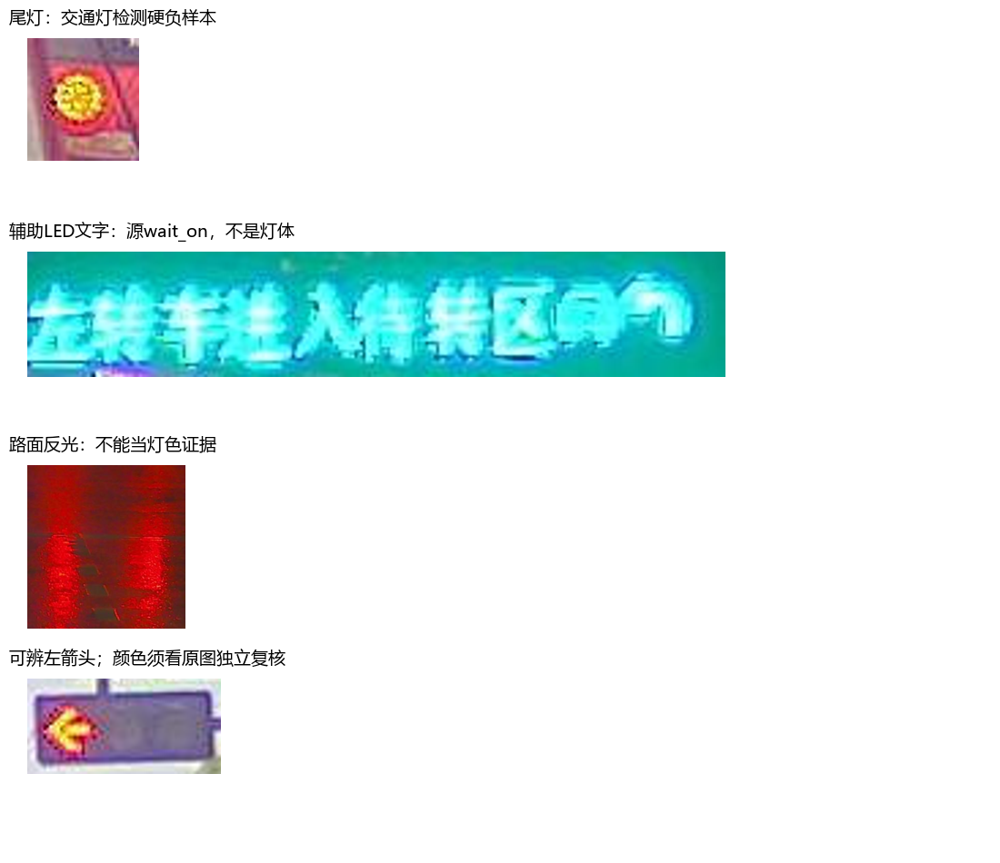

# PC交通灯：第一阶段交付

2026-10-24（Asia/Shanghai）。**已形成硬件、数据、标注和部署预检材料；未训练，当前不满足开训条件。** 新内容全部位于本目录；没有修改FPGA、网络、现有香橙派服务或稳定模型。954个既有源码/模型/配置文件结束哈希核对通过，见[保护文件核对](reports/protected_after_check.json)。

## 结论与交付入口

|事项|实际结果|材料|
|---|---|---|
|GPU硬件|RTX4060 Laptop，8188MiB显存，驱动617.14；64MiB驱动显存操作通过，硬件适合轻量微调|[GPU与环境报告](GPU与环境报告.md)|
|训练环境|独立Python3.11；CPU Torch/ONNX预检环境可用，依赖检查通过；CUDA包下载中止，PyTorch GPU训练未验证|[实际依赖版本](reports/environment_freeze.txt)、[已有环境盘点](reports/existing_environments.json)|
|基线审核|分开定位灯体错误、缩小损失、候选/颜色后处理错误及不可辨真值；发现部分旧raw证据有叠字污染|[基线失败审核](基线失败审核.md)、[权重身份核对](reports/checkpoint_identity.json)|
|数据|官方链接的S2TLD镜像，Apache-2.0数据卡；1080p包1,222图已下载校验，抽取400候选，合格0|[数据与划分方案](数据与划分方案.md)、[逐图清单](data/candidates.csv)、[来源SHA](data/archive_provenance.json)|
|标注规范|区分body/group/lens/emitter，机动车/行人/未知、颜色可辨性、箭头、遮挡、off与unknown；控制归属unknown|[标注规范](标注规范.md)、[红绿样例JSON](annotations/examples.json)、[负样例JSON](annotations/hard_negative_examples.json)|
|划分|四个原片全片作为开发/回归；400候选暂不划分。87对疑似近重复需复核，候选时间段不能冒充独立路口；独立泛化集尚未收集|[划分状态](data/split_plan.json)、[去重候选](reports/near_duplicate_candidates.json)|
|模型与导出|YOLOv8n标准两类灯体模型；随机初始化结构预检通过，部署导出6个原始头，CPU DFL/NMS；没有识别精度结论|[模型与部署路径](模型与部署路径.md)、[算子核对](算子核对记录.md)、[数值预检](reports/deployment_preflight.json)|
|RKNN及板端|官方2.5.0算子文档已核对并据此修正导出；Linux FP16 build、RKNN数值一致性、板端耗时和INT8损失均未实测|[离线验证交接](板端离线验证交接.md)|

## 关键数据发现

400张候选源标签共803框（red408、green271、yellow23、wait_on99、off2），不等于803个合格交通灯。部分`wait_on`实际是辅助LED文字，不可直接当灯色；部分源框带倒计时，需依新body/emitter定义重画。尾灯、LED招牌及雨夜反光已选出局部负样例，未虚报整图负样本配额通过。

源框短边<8px仅1个；行人灯、off、极小目标与可辨箭头的覆盖仍需补充和复核。40张联系表目视初筛确认包含中国道路横排/竖排与夜间雨天，但不是400图完整标注验收。400张数量只支持流程验证。

## 标注样例

蓝框为灯体，橙框为发光区；夜间颜色可辨，过曝形状仍unknown。以下只是局部首轮目视样例，不是完整图片标签或独立复审真值。

## 正式训练前必须补齐

1. 逐图检查漏标/错标与干净原图，完成有签署的标注复核，统计类别及可辨性缺口；源XML/自动标签不直接当真值。
2. 核实路口、视频、连续场景与近重复连通组后冻结训练/开发/保留清单；另收集未参与调参的独立最终测试场景。
3. 在隔离Linux环境用选定同SHA ONNX完成RKNN FP16 load/build，保存失败节点或成功日志。若失败先修导出，不能先正式训练。
4. 独立CUDA环境完成PyTorch GPU前后向/AMP资源试跑，再据显存决定batch和分辨率；不得把驱动测试当作Torch训练验证。

[训练门槛机器报告](reports/readiness.json)：`ready_to_train=false`，400候选/0合格。复查可运行 `python scripts/check_readiness.py`；未就绪返回退出码2，不触发训练。本目录没有一键训练入口。

后续验收分别报告灯体、可辨灯色、箭头及小目标，另报告ONNX/RKNN一致性、板端耗时和INT8损失。控制方向归属属于后续空间推理，不因检测训练而自动解决。
