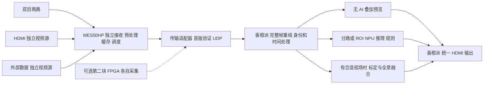

# 紫光同创 FPGA 高级辅助驾驶系统（ADAS）比赛开发文档

> **当前方针（2026-10-19）：**外部开源项目仅作方法与模块参考，未指定任何仓库为开发底座。优先验证单块 MES50HP 的混合四路输入；确需四颗实体摄像头时，再比较双板各自采集、香橙派汇总。系统所有正常显示均由香橙派输出，无 AI 叠加预览与识别显示共用接收服务。通信接口由带宽和实现代价决定，当前建议先验证千兆以太网。详见 [GitHub 开源方案对比与自主开发方针](GitHub开源方案对比与自主开发方针.md)。第 15 章跨板安装、同步和恢复内容适用于选择双板后的分支。

> 面向：全国大学生嵌入式芯片与系统设计竞赛 2026，FPGA 创新设计赛道，紫光同创选题三。  
> 编制日期：2026-10-19。版本：V1.3，2023／2026 赛题原文对比与开发任务映射版。  
> 基础资料：本项目 `资料/` 目录；参赛方向由用户明确指定为 ADAS。  
> 用户确定的 ARM 平台：香橙派 5，16GB，RK3588S（用户已核实）。用户以完整制作作品为目标，明确不以该处理器满足比赛限制为前提。  
> 四路硬件规划：先验证单板双目两路、HDMI 一路与外部数据一路；双 MES50HP 各采两路为实体四摄像头候选。第二板不是默认采购项，所有并行采集路径尚待实物验证。  
> 状态说明：本文给出待开发方案、工程约定和验收建议。没有连接实物进行编译、下载、测速或模型推理，文中的性能目标均不是已实现成绩。

## 阅读导航

1. [项目判断与推荐路线](#1-项目判断与推荐路线)
2. [资料审查与事实依据](#2-资料审查与事实依据)
   - [2023／2026 赛题对比与复用边界](#24-20232026-赛题对比与复用边界)
3. [赛题需求及验收映射](#3-赛题需求及验收映射)
4. [成果范围与功能分级](#4-成果范围与功能分级)
5. [硬件选型与采购准备](#5-硬件选型与采购准备)
6. [技术栈与学习顺序](#6-技术栈与学习顺序)
7. [系统架构与数据流](#7-系统架构与数据流)
8. [输入视频与现场-u-盘方案](#8-输入视频与现场-u-盘方案)
9. [性能带宽与存储预算](#9-性能带宽与存储预算)
10. [fpga-详细设计](#10-fpga-详细设计)
11. [armlinux-软件设计](#11-armlinux-软件设计)
12. [通信协议与寄存器约定](#12-通信协议与寄存器约定)
13. [感知算法与-ai-开发](#13-感知算法与-ai-开发)
14. [行为决策与告警状态机](#14-行为决策与告警状态机)
15. [多路视频与高阶功能](#15-多路视频与高阶功能)
16. [分阶段开发步骤](#16-分阶段开发步骤)
17. [计划分工与关键路径](#17-计划分工与关键路径)
18. [测试验收与性能测量](#18-测试验收与性能测量)
19. [调试排障与风险管理](#19-调试排障与风险管理)
20. [源码管理部署与交付](#20-源码管理部署与交付)
21. [演示答辩与创新点](#21-演示答辩与创新点)
22. [立即执行清单](#22-立即执行清单)
23. [资料引用与待确认事项](#23-资料引用与待确认事项)

---

## 1. 项目判断与推荐路线

### 1.1 这个比赛最终要做什么

做出一个以紫光同创 FPGA 为核心、与香橙派 5 ARM 处理器协作的道路视频感知与模拟驾驶辅助系统。系统能接收摄像头或视频输入，识别道路信号与目标，根据按键模拟的驾驶意图，给出行驶、停止、转向和报警结果，并通过 HDMI 图像叠加、LED 等输出。

最清晰的成果形态是一个可独立运行的桌面演示平台：先用一块 FPGA 建立单路基线，再验证混合四路输入；如需要四颗实体摄像头，再评估两块 MES50HP 各采两路。配一块香橙派 5 16GB、一台显示器、必要的网络/转接设备、按键与指示灯，以及可播放测试视频的输入链路。赛题允许使用按键、LED 和图像叠加模拟驾驶行为，不要求先造一辆真正能上路的汽车。[S1，PDF 物理第 14–16 页]

建议作品名称：**基于紫光同创 FPGA 与 ARM 协同的多场景道路感知及驾驶辅助演示系统**。名称中的“多路”“低延迟”“实时”等描述，最终只能保留有实测支持的部分。

### 1.2 对当前项目的结论

当前目录是一套约 4.39 GB 的赛题与开发板资料库，原始文件共 6,896 个，其中有 120 个 PDF、804 个 `.v` 文件、82 个 `.pds` 文件，以及大量日志、网表、数据库和重复副本。这些数量不包含压缩包内部文件，也不代表有同样数量的独立设计。

目录提供了 FPGA 视频链路和外设开发的基础，但尚未发现独立的 ADAS 应用工程、训练数据集、目标检测模型、完整 ARM 项目或已经完成的交通决策代码。最有价值的起点是盘古 50K 的 HDMI、DDR3、OV5640、以太网与按键例程。

**推荐路线：独立模块和协议规格 → 一块 MES50HP 单路闭环 → 同板双目并行 → 单板混合四路验证 → 按需求扩展双板实体四摄像头 → 时间对齐与标定融合。**先打通官方明确测试场景，再增加夜间增强、行人识别和导航理解。两块板直接烧录原单路选择例程，不会自动得到四路并行采集。

### 1.3 四路硬件路线选择

| 路线 | 适用情况 | 主要做法 | 首要风险 |
|---|---|---|---|
| E：单 MES50HP + 双目 + HDMI + 外部数据输入（优先验证） | 比赛式多场景演示，允许混合视频来源 | 四个独立输入各自 CDC/缓存，ARM 汇总识别显示 | 双目并行和网络像素输入仍需开发，四流不自动等于真实环视 |
| A：两块 MES50HP + 两套双目 + 香橙派 5（实体四摄像头候选） | 保留现有板型，避免自制采集 PCB | 每板双路采集与预处理，经交换机发送四路图像，香橙派融合、识别、显示 | 每板双路 RTL、汇总带宽、跨板时间对齐与相机安装 |
| B：带匹配 FMC 的 FPGA 平台 + 双 40pin 子卡 | 希望单块 FPGA 接四路 DVP | 接两套双目，单 FPGA 内部完成四路缓存与调度 | 需换平台，并核对 FMC、电压、时钟及配套工程 |
| C：MES50HP + 自制主动四路汇聚板 | 希望只占原双目插槽并愿意设计 PCB | 前端 FPGA/桥接芯片采四路，缩放/汇聚后经原接口输出 | 额外硬件、存储、电源、同步与接口带宽开发 |
| D：四路 USB 摄像头接香橙派 + MES50HP | 快速验证软件全景与识别算法 | 香橙派采集并拼接，FPGA 处理合成视频或参与告警 | 不能作为“四路由 FPGA 独立采集”的证据 |

用户已确定香橙派 5 16GB/RK3588S。四路视频不强制理解为四颗直接连接的摄像头；当前优先验证 E，A 作为后续实体四摄像头的候选。外部工程只作比较，不默认克隆其中某个项目为系统底座，详见新增开源方法专题及第 15 章。

所有模式均由香橙派完成正常的 OSD 和 HDMI 最终显示。FPGA HDMI-OUT 可用于板级排障，但不作为系统必需输出；检测框不再回传 FPGA 绘制，LED/告警/按键等小消息仍可双向通信。先将原预览和识别视图作为统一程序的显示模式，再按需要增加独立脚本入口和共享帧服务。官方处理器限制作为规则事实保留；本作品按用户决定使用 RK3588S。[S1]

### 1.4 三个会导致项目走偏的误区

- 在电脑上运行所有识别算法，仅让 FPGA 点亮 LED：难以体现软硬协同，作品应在香橙派和 FPGA 上完成实际闭环。
- 把四画面拼接等同于四路 FPGA 并行采集：必须证明每路输入独立、帧号可追踪、数据经 FPGA 接收处理。
- 先做漂亮界面，最后再接硬件：视频格式、CDC、DDR、通信吞吐和现场数据接入通常比界面更容易阻塞进度。

## 2. 资料审查与事实依据

### 2.1 审查方法与边界

对原始目录做了完整文件清点，对 120 个 PDF 执行文本提取，重点阅读并核对赛题、MES50HP 硬件手册、HDMI/DDR/摄像头/PCIe/以太网例程说明；对赛题 ADAS 关键页进行页面渲染核对。解包检查了摄像头例程的关键 RTL，检查了 PCIe ZIP 内的驱动、应用及工程目录。

这不是对数千个生成文件进行逐行代码审计。芯片数据手册作为接口与限制的查证材料；图片式点位图、CAD 原理图和 PCB 文件需在接线时按实物继续核对。没有执行旧安装包、启动旧调试程序，也没有验证任何既有 `.sbit` 能在当前实物工作。

完整原始文件索引见同目录《资料文件索引.csv》，逐份 PDF 与资料类别审查见《资料审查清单.md》。同名 `(1)` 文件不自动视为完全相同，以清单中哈希分组为准。

### 2.2 各类资料如何用

| 资料类别 | 作用 | 本项目使用优先级 | 使用建议 |
|---|---|---|---|
| `资料/紫光同创.pdf` | 赛题目标、平台与现场评测要求 | P0 | 以选题三为准建立需求矩阵；其他题的限制不能直接套用 |
| `盘古50K开发板/3_Hardware` | FPGA 型号、接口、时钟、电源、引脚和连接座 | P0 | 接线、约束和资源预算依据；和板卡版本交叉核对 |
| `1_Demo_document/工具使用篇` | PDS 安装、建工程、IP、仿真、下载固化 | P0 | 先跑通一个小工程，再移植视频工程 |
| `2_Demo/01` 至 `11` | LED、按键、I2C、UART、HDMI、DDR、HSST、PCIe、摄像头、网络 | P0/P1 | 提取可复用模块，保留厂商原版基线 |
| `OV5640双目摄像头资料/实验例程1-基于盘古50K` | 与当前板型匹配的摄像头路径 | P0 | 比其他板型例程更适合首版 |
| `OV5640双目摄像头资料/实验例程2/3/4` | PGX-NANO、200K-MINI、100Pro+ 等平台示例 | P2 | 学习结构；PLL、DDR、引脚、IP 不能原样用于 50K |
| `MES50H-HDMI视频板` | 三路 HDMI 输入底板和切换示例 | P1/P2 | 若拥有该底板可复用配置；不等于四路同时处理 |
| `MES50HP-网口板` | YT8614/QSGMII 多网口底板和级联例程 | P2 | 特定底板用途，不能替代默认 RTL8211E/RGMII 例程 |
| `PCIE资料/pcie_test_platform_v1_0(1).zip` | Linux 驱动、GTK 测试程序、DMA 参考 RTL | P1/P2 | 可研究 DMA 协议，需确认器件、内核与 ARM DMA 兼容性 |
| `PDS开发软件安装包` | PDS 2022.2 SP6.4、Lite 包与辅助说明 | P0 | 和旧例程 2022.1 的版本差异要建立记录 |
| `4_IC_datasheet` 与摄像头芯片数据 | OV5640、MS7200/7210、RTL8211E、电源等资料 | 按需 | 查协议、时序、寄存器及电气要求 |
| `ADDA模块资料` | ADC/DAC、OLED、SPI 屏和波形实验 | P3 | 非 ADAS 主线；不应为“用完资料”而引入 |
| `PMOD音频模块组合` | I2S 音频采集播放例程 | P3 | 仅在确需语音告警且主线完成后使用 |
| `.log/.db/.vm/.netlist/.sbit` 等 | 旧工程构建与下载产物 | 参考 | 帮助定位版本与历史问题，不代表当前结果 |
| VESA、点位图、CAD 文件 | 显示时序、定位与结构参考 | 按需 | 实际约束和连线必须结合对应版本硬件 |

### 2.3 已核实的关键事实

1. MES50HP 主芯片是 **PGL50H-6IFBG484，Logos 系列**。它与 PG2L100H/PG2L200H 所属的 Logos-2 不是同一器件系列。[S2]
2. MES50HP 手册给出 42,800 个 LUT6、64,200 个 FF、134 个 18Kbit DRM、84 个 APM。资源统计口径以当前 PDS 对应器件报告为准，不把 LUT4、LUT6 和营销“50K”直接混用。[S2，表 2-1]
3. 手册给出两颗各 4Gbit DDR3、合计 1GB，32bit 位宽、最高 800MT/s，理论带宽为 3.2GB/s。这是上限，不能作为实际应用带宽承诺。[S2、S5]
4. 摄像头例程说明设置为 **1280×720、30fps、RGB565**。关键 RTL 中 `CMOS_1`/`CMOS_2` 用编译宏选择一路输入 `fram_buf`，不是双路并行处理。[S3]
5. 摄像头模组通过 DVP 以 8bit 总线分两拍传一个 RGB565 像素。例程文字称其为“8bit RAW”容易混淆，这里不能据此把数据当作 Bayer RAW 做去马赛克。
6. 摄像头顶层对 RGB565 红蓝位段做交换；移植时需用纯红绿蓝图验证，不能从文件名猜像素顺序。[S3，`hdmi_ddr_ov5640_top.v`]
7. HDMI 基础说明中的彩条/环路为 **1920×1080@60 RGB888**，与摄像头例程 720p30 不同。必须统一输入、处理、缓存、输出格式。[S4]
8. 基础 PCIe 例程的实验目的是“PC 识别到板卡”。设备枚举成功不等于持续视频 DMA 已完成。[S6]
9. PCIe ZIP 含 `PG2L100H_PCIe_DMA` 工程、Linux 驱动和 GTK 应用。它提供进一步参考，但还不能证明 PGL50H+RK3588S 的完整 DMA 链路可用。[S9]
10. 三路 HDMI 底板 demo 是选择一路环路输出，示例有按键组合选择像素时钟的写法。正式多路系统应采用每路时钟域接收、CDC 与统一显示时钟，不能直接照搬异步时钟切换。[S8]
11. 默认千兆网口使用 RTL8211E PHY，例程提供 ARP、UDP；八网口底板采用 YT8614 与 QSGMII，属于另一种硬件拓扑。[S7、S10]
12. 当前库的 PDS 包与旧文档存在路径、版本和 demo 序号差异，遇到不一致要以实际压缩包、工程内容和实物为准。

### 2.4 2023／2026 赛题对比与复用边界

**原文核查结论：两年赛题共享视频采集与图像处理技术，但任务目标、架构要求和验收场景明显不同。“2023 年赛题与今年几乎一样”不能作为开发依据。**2023 年没有 ADAS 选题，相关视频作品适合作为模块参考，不能直接视为今年选题三的完整实现。[S1、S14]

本次逐页提取并核对用户提供的两份原始 PDF：2023 年共 3 页，今年共 17 页；另外渲染检查了 2023 年第 1 页的输入输出框图。2023 年原件已原样复制到项目资料目录，便于随手册一起查阅；原始来源路径与校验值另存说明，不修改用户下载的原件。

- [2023 年紫光同创选题指南](../资料/2023年紫光同创选题指南.pdf)：赛题一在第 1 页，赛题二跨第 1–2 页，赛题三在第 2 页，平台说明在第 3 页。
- [2026 年紫光同创选题指南](../资料/紫光同创.pdf)：选题三 ADAS 在物理第 14–16 页，MES50HP 在第 6 页。

| 方向 | 2023 年选题 | 2026 年选题或对应内容 | 开发含义 |
|---|---|---|---|
| 视频图像 | 赛题一：多媒体视频处理魔盒 | 选题二：任意角度的畸变矫正；选题三：高级辅助驾驶系统 | 通用视频效果与道路感知系统分开评估；任意旋转也不能直接当作相机畸变矫正 |
| 网络通信 | 赛题二：PCIe 网络数据采集卡 | 未单列同名题；ADAS 等任务包含高速通信 | 网卡透传、设备枚举经验可以参考，视频帧协议和 ARM 端接收仍需开发 |
| RISC-V | 赛题三：基于 RISC-V 的多功能游戏机 | 选题一：RISC-V 指令集 CPU 设计 | 从移植与游戏应用转向 RV32I 内核、至少三级流水线和 CoreMark 测评 |
| 开放应用 | 未单列开放选题 | 选题四：基于紫光同创 SOPC 的创新应用开发 | 新增独立开放应用方向，不能把该题的平台约定自动套用到 ADAS |

**同为“第三题”不表示同一方向：2023 年第三题是游戏机，今年第三题才是 ADAS。**本项目应比较 2023 年视频魔盒与今年 ADAS，而不是按题号沿用往届设计。

### 2.5 视频魔盒与 ADAS 的逐项差异

| 项目 | 2023 年视频魔盒 [S14，第 1 页] | 2026 年 ADAS [S1，第 14–16 页] | 本项目处理 |
|---|---|---|---|
| 系统目标 | 拼接、缩放并实时显示视频；增加各种处理效果 | 感知道路环境，输出模拟驾驶行为和告警 | 视频通路与道路决策分别建模块、分别验收 |
| 视频输入 | 明确双目摄像头、HDMI | 基础任务允许 HDMI、摄像头或其他图像输入接口 | 混合输入可作为开发方案；每路需证明独立来源和 FPGA 数据路径 |
| 输入路数 | 未规定至少四路独立视频流 | 高阶任务明确至少四路并行采集和低延迟传输，模拟前后左右 | 单路、双路只是阶段成果，四路需单独验收 |
| 以太网用途 | 字符输入并叠加到图像 | 未将以太网限定为字符输入；接口按实现选择 | UDP 视频接收为新增设计，不能当作旧题现成功能 |
| 图像处理 | 融合、去噪、缩放、旋转、亮度色度调整、字符叠加 | 灰度、去噪、二值化、色彩转换等，并服务于道路感知 | 先复用像素模块，再验证其对感知效果和传输量的实际价值 |
| 拼接目标 | 不同输入的拼接展示 | 拼接或融合，模拟汽车全景影像 | 四宫格用于联调，几何全景需另做视场、标定、投影和接缝验证 |
| 处理器协同 | 未明确要求外接 ARM 或处理器端 AI | 强调软硬协同；高阶任务要求 MCU 端轻量 AI 多路识别和规划 | FPGA 承担实质采集/处理，香橙派做语义识别、规则和显示 |
| 驾驶规则 | 无明确道路驾驶任务 | 红绿灯、实虚线、导航与其他道路场景 | 按第 14 章建立独立状态机，检测框展示不能替代决策功能 |
| 输出 | FPGA 参考框图直接 HDMI 输出 | 基础任务支持 LCD/HDMI，未明确限定最终显示接口必须来自 FPGA | 保留香橙派统一输出主线；FPGA HDMI 为可选调试 |
| 现场输入 | 这份指南未详细列出统一测试素材 | U 盘提供全部或部分道路图片/视频测试场景 | 文件输入与摄像头输入均需验证，不能只准备相机演示 |
| 性能和材料 | 这份指南未给出详细量化评测和材料清单 | 强调延迟、实时性、资源、时序、数据流报告、实物与源码等 | 用最终构建版本提交可复现证据，不把旧作品成绩作为本项目成绩 |

2023 年第 3 页提出“逻辑规模尽量控制在 50k 以内，在同等性能下逻辑规模更小的作品更优”，这是往届文字；今年平台扩展至 Logos2、SOPC 等，并仍列出 MES50HP。不能把往届的 50k 建议自动当作今年所有平台的硬性上限。当前 MES50HP 的真实资源预算仍按器件报告执行。[S14，第 3 页；S1，第 3–8 页]

### 2.6 四路输入、字符输入与文件回放的证据边界

2023 年原文写明：

> 视频的输入源为双目摄像头和 HDMI，叠加字符的输入源为以太网口，视频的输出为 HDMI。

其基础任务把双目摄像头称为输入源 1、HDMI 称为输入源 2；参考框图的源编号与正文顺序不同，但均只区分这两类视频来源，不改变接口含义。双目左右若分别采集，可得到两路相机画面，加一路 HDMI；文档没有因此要求第四路独立视频。框图明确将以太网标为字符输入，也没有规定光口作为第四路视频输入。[S14，第 1 页]

今年高阶任务明确：

> 实现至少四路的视频流的并行采集与低延迟传输（模拟车的前、后、左、右），优化数据流带宽。

该段没有把四路全部限定为直接连接的摄像头。按本作品的开发目标，可继续验证双目两路、HDMI 一路、外部数据一路；但外部视频的产生设备、输入协议、FPGA 接收路径、通道身份与前后左右语义必须落实。接口存在不代表已具备相应视频输入逻辑。光口和网口均需协议端点及像素解包，不能接线后自动成为视频源。[S1，第 14 页]

| 演示或测试 | 可以证明 | 不能单独证明 |
|---|---|---|
| 四个显示窗口 | 显示布局和窗口调度 | 四路独立采集；同一输入复制不算新增来源 |
| 香橙派本地读取四个文件 | 多流解码、识别和决策软件能力 | FPGA 四路并行采集及传输能力 |
| 文件解码为像素后送 FPGA 处理，再回传香橙派 | 外部像素输入、FPGA 实质处理和软硬闭环 | 四个文件具有真实四方向光学覆盖，或已实现相机曝光同步 |
| 四个独立输入经 FPGA 并行处理，并记录每路帧号/吞吐/延迟 | 所实现链路的多路采集与传输能力 | 未测试条件下的更高帧率或真实 360° 几何全景 |

今年允许用现场提供的视频和图片验证道路功能，不意味着四路数据可以完全绕过 FPGA。第 8 章负责文件输入闭环，第 15 章负责多路采集与全景，两者分别留下证据。ADAS 章节未统一规定四路输入均为 1080p，也未给统一 FPS/延迟阈值；1080P、3 分钟以内是提交演示视频的规格，640×360@15/30fps 等为本手册内部起步目标。[S1，第 14–16 页]

### 2.7 往届模块复用与今年新增工作包

以下“可参考”均要求先核对源码、许可、器件/IP 和接口，再进行移植验证。用户提供及后续找到的仓库均不自动成为开发底座；不能从视频效果倒推出未检查的实现。

| 工作包 | 可参考的往届方法 | 今年需要补齐的实现 | 对应章节与验收 |
|---|---|---|---|
| 视频入口 | OV5640 初始化、DVP 两拍拼像素、HDMI 接收 | 双目真正并行、独立第四路输入、逐路 CDC 和帧统计 | 第 10、15 章；T01、T18、T26 |
| 缓存与调度 | DDR 帧缓存、显示读写时序 | 多路公平调度、完整帧发布、有界队列和断流恢复 | 第 9、10、12 章；T13–T15、T19 |
| 像素处理 | 缩放、去噪、亮度调整、拼接 | 对照软件基准，保留小交通灯/行人所需 ROI，验证增强收益 | 第 10、13 章；T01、T12 |
| FPGA—ARM 通信 | 网口或 PCIe 协议、驱动与 DMA 结构 | 按当前板型实现帧协议、重组、会话、控制和吞吐测试 | 第 11、12 章；T13、T14、T22 |
| AI 感知 | 只复用确有源码与证据的模型部署方法 | RK3588S 的 RKNN 推理、灯车道关联、线型、行人、导航 | 第 13 章；T05–T12 |
| 驾驶行为 | 按键消抖、LED 驱动和文字叠加机制 | 红灯强行行驶、强制实线变道、冲突优先级及未知降级 | 第 14 章；T02–T11、T17 |
| 全景与输出 | 多窗口、图形绘制和拼接结构 | 香橙派统一输出，共享接收服务；需要几何全景时增加标定融合 | 第 11、15 章；T24、T25 |
| 现场与交付 | 工程组织和调试方法 | 陌生 U 盘素材、完整场景日志、最终时序/资源/性能、源码包 | 第 8、18、20、21 章；T16、T20、T27 |

### 2.8 将对比结论落实到开发顺序

1. **阶段 0 冻结当届需求与来源表。**以今年 R01–R14 为主线，将往届效果标为参考；列出四个独立输入的设备、接口、格式、方向、FPGA 路径和验证状态。
2. **阶段 1–7 建立单路实物闭环。**先证明输入确实经过 FPGA 处理、香橙派接收与识别、香橙派 HDMI 输出；并行用道路素材建立软件基准。
3. **阶段 8–9 完成道路规则和现场输入。**先覆盖红绿灯与实虚线，再完善导航、行人和复杂场景；检测与决策分开验证，文件模式不直接旁路 FPGA。
4. **阶段 10 扩展双路、四路及全景。**逐路验证独立性、缓存、吞吐、延迟和恢复；确需实体四摄像头时再进入双板分支。四宫格与标定全景分别验收。
5. **阶段 11 固定交付证据。**对最终源码、bitstream、模型和测试集记录版本，提交实测值与支持范围；不把往届要求、参考工程宣称或内部目标写为今年已完成成绩。

## 3. 赛题需求及验收映射

### 3.1 官方要求与内部目标分开管理

本节中的“官方”来自选题三；“建议目标”是用于开发管理的内部验收线。选题三未给出统一数值化的 FPS、延迟、mAP 或各项评分权重；1080p30/60 的示例出现在选题二，不能误写为 ADAS 的固定硬性指标。选题三明确要求提交 **1080P 演示视频、3 分钟以内**，这是提交视频规格。[S1]

| ID | 官方要求或评测场景 | 本系统实现 | 验证证据 | 优先级 |
|---|---|---|---|---|
| R01 | 以紫光同创 FPGA 为核心，软硬协同 | FPGA 做采集、预处理、缓存、输出；ARM 做感知与决策 | 架构图、RTL、实物数据流与性能对比 | P0 |
| R02 | 摄像头/HDMI 等输入，LCD/HDMI 输出 | 摄像头模式和现场视频回放模式 | 两种输入源的实物演示 | P0 |
| R03 | MCU 与 FPGA 高速通信，如 PCIe | 首版千兆以太网传识别帧与元数据；条件具备后升级 PCIe | 实测有效吞吐、丢包、往返延迟 | P0 |
| R04 | 基础图像处理及道路感知 | FPGA 灰度、滤波、ROI、缩放/特征；ARM 语义识别 | 软件金标准对比及实时结果 | P0 |
| R05 | 红灯停、绿灯行、红灯强行行驶报警 | 关联当前车道信号灯与驾驶输入 | 真值标注、状态日志、告警画面 | P0 |
| R06 | 虚线变道、实线直行、强制实线变道报警 | 目标方向车道线识别与请求判定 | 左右方向分别测试 | P0 |
| R07 | 真实视频导航模拟智驾 | 导航提示解析、路线意图与道路规则融合 | 带导航视频测试，展示识别来源 | P0，方案逐步完善 |
| R08 | 行人等额外 1–2 类场景 | 行人进入行驶走廊时模拟制动告警 | 视频级漏检、误报与反应时间 | P1 |
| R09 | 拼接/融合、全景影像展示 | 香橙派先做四宫格，再做标定、投影与接缝融合 | 标定记录、多路帧号、拼接效果、分辨率/FPS | P1 |
| R10 | 至少四路并行采集与低延迟传输 | 先单板混合四路；实体四摄像头可选双板独立采集并上传 | 四路独立动态输入、每路连续性、跨板时间偏差 | P2，高阶 |
| R11 | MCU 端轻量模型，多路实时识别与规划 | ARM NPU 推理、异步调度与决策 | 每路感知 FPS、P95 延迟、模型精度 | P1/P2 |
| R12 | 夜间/复杂路口等完整场景 | 增强前后对比、信号灯关联、低置信度降级 | 分场景测试集与消融实验 | P1 |
| R13 | 工程规范与性能报告 | 模块化源码、约束、CDC、资源与性能报告 | 干净环境重建和报告 | P0 |
| R14 | 硬件实物、源码、技术文档、演示视频 | 固定版本交付包 | 交付清单和离线彩排 | P0 |

注意：P2 是团队开发顺序，不代表官方高阶任务可以忽略。最终以官方当届通知和评测安排为准。

### 3.2 最小可参赛闭环

至少具备：已确定的 FPGA+香橙派平台、一路视频经 FPGA 实质处理、ARM 与 FPGA 数据交换、红绿灯和实虚线场景、驾驶按键、告警输出、现场视频加载、启动与故障恢复、可复现的技术材料。

“最小闭环”只是内部里程碑；没有完成导航或其他被现场抽测的场景时，应明确列为欠缺，不能对外宣称完整覆盖官方测试。

## 4. 成果范围与功能分级

### 4.1 分级交付

| 版本 | 必须做出的行为 | 进入下一阶段的条件 |
|---|---|---|
| V0 硬件基线 | LED/按键/UART、HDMI 彩条、摄像头或 HDMI 画面、DDR 测试 | 各模块独立验证通过，版本可恢复 |
| V1 单路闭环 | FPGA 预处理、ARM 接收识别帧、规则决策、香橙派 OSD、LED 控制、U 盘视频回放 | 核心场景可连续重复测试，无不可解释卡死 |
| V2 场景完整 | 红绿灯、左右实虚线、行人、导航输入、异常处理、完整报告 | 视频级测试通过且无数据泄漏 |
| V3 多路与全景 | 单板混合四路或双板扩展、带宽与时间对齐、标定融合、模型及延迟优化 | 四路独立输入、汇总与逐路统计通过；四宫格/全景分别验收 |

### 4.2 建议内部指标

- 主显示目标：先 1280×720@30；必要时首轮用 640×480 降低调试成本。稳定后再评估 1080p。
- 首版感知帧率目标：单路至少 10fps，争取 15–30fps；显示 FPS 与模型推理 FPS 分开报告。
- 单路感知到告警目标：P95 不超过 150ms；总显示端到端目标争取不超过 200ms，实测后修订。
- 长稳目标：首轮连续 30 分钟，交付前连续 2 小时；记录帧丢失、重启次数、温度和资源。
- 受控验证集目标：红灯强行行驶、实线强制变道等关键事件召回率争取 ≥95%；必须同时报告样本数、误报与置信区间/波动，不能作为真实道路安全保证。
- 资源规划：给 LUT、DRM、APM 留约 20% 调试与迭代空间；这是预算原则，不是厂商规定。

## 5. 硬件选型与采购准备

### 5.1 基线与四路目标物料清单

| 物料 | 数量 | 要确认的条件 |
|---|---:|---|
| MES50HP 开发板 | 首版 1 块；实体四摄像头候选 2 块 | 型号、底板版本、供电、JTAG、DDR、HDMI、网口；分别编号 A/B |
| 香橙派 5 16GB | 1 | 已确认 RK3588S；核对板卡接口版本；千兆网、USB Host、HDMI 输出、供电散热、BSP 与 NPU 运行时 |
| OV5640 双目模组 | 基线 1 套，四路共 2 套 | 每板连接一套；四镜头能否分开放置、视场是否适合环视需确认 |
| HDMI 显示器与 HDMI 线 | 1 台、2 根以上 | 支持选定时序；720p30 的兼容性要提前验证 |
| 千兆网线 | 四路至少 3 根 | A→交换机、B→交换机、交换机→香橙派，均协商 1000Mbps 全双工 |
| 千兆交换机 | 四路 1 台，至少 3 个可用千兆端口 | 实际背板/转发能力；香橙派端仍只有一条千兆上联 |
| FPGA 配套电源 | 每板 1 套 | 两块板分别供电，不从摄像头插槽给另一块开发板供电 |
| USB 转 UART、JTAG 下载器 | 按板卡配套 | 驱动、线序、电平和串口占用 |
| U 盘及独立电源 | 各 1–2 | 可离线加载测试数据，电源余量足够 |
| 三脚架/固定支架、测试图卡 | 按需 | 保证重复测试时摄像头角度一致 |
| PCIe 转接与连接组件 | 升级时采购 | RC/EP 角色、lane、refclk、PERST、供电和连接器全部匹配 |

不填写未经询价的固定价格。预算按“板卡/处理器/输入设备/显示与线材/工具/备件”分类，预留约 10%–20% 机动费用。

### 5.2 必须先确认的硬件缺口

1. 资料在目录里不代表已经拥有对应实物。先拍照记录芯片丝印、底板版本、连接器和电源配置。
2. MES50HP 没有内置 ARM。若采用 RISC-V 软核代替 ARM，要额外开发工具链与软件平台，并评估其运行感知算法的能力，通常不适合作为零基础首版捷径。
3. 单个原双目接口不能被动分线成四路独立 DVP。四路可采用单板混合输入，或两块 MES50HP 各接一套双目的实体四摄像头路线；仍需验证双路并行 RTL 与 DDR/网络调度，不能直接复用单路选择逻辑。
4. 核心板共用不等于多个底板可同时插接或同时拥有所有接口。切换底板会改变引脚与外设资源。
5. 不把 PCIe 板边接口接到任意 ARM 转接器；先得到电气与连接定义，确认香橙派具体型号提供实际可用的 Root Complex 接口，且不与系统盘冲突。

### 5.3 接线与上电检查

断电接摄像头，核对第 1 脚与排针方向；I/O 不可直接接 5V；核对所有扩展模块的 VCCIO、供电与地。若摄像头占用扩展口，不预设仍有空余引脚能连 SPI/UART。

建立 `pin_plan.csv`，记录“顶层信号、FPGA 管脚、Bank、I/O 标准、外设脚、方向、时钟域、来源手册页”。最终约束必须从当前版本硬件核对产生，本文不提供未经核对的具体管脚编号。

两块相同板型可共用 RTL 和经核对的约束，但分别设置板号、MAC/IP、通道映射与会话。若增加同步线，仅使用已核对且未占用的兼容 I/O，电平一致并共地；同步参考线与摄像头曝光触发不是同一个概念，不在未验证时宣称硬同步。

## 6. 技术栈与学习顺序

### 6.1 技术栈

| 层次 | 技术 | 要掌握的能力 | 可交付物 |
|---|---|---|---|
| FPGA 逻辑 | Verilog/SystemVerilog、PDS | 同步设计、流水线、模块接口、综合与布局布线 | RTL、PDS/Tcl、约束 |
| 视频接口 | DVP、RGB565/RGB888、HS/VS/DE、HDMI PHY | 像素格式、行场时序、颜色顺序、配置 | 输入与输出适配器 |
| 存储 | FIFO、DRM、DDR3、类 AXI 接口 | 跨域、突发、帧缓存、仲裁 | 缓存管理器与压力测试 |
| 协同通信 | RGMII/MAC、ARP/IPv4/UDP；可选 PCIe DMA | 分包、帧重组、吞吐、超时、数据一致性 | 通信协议与收发程序 |
| 嵌入式 | ARM Linux、BSP、C/C++、CMake | 设备访问、线程、内存、日志、离线启动 | ARM 服务与部署脚本 |
| 图像算法 | OpenCV、颜色/梯度/形态学、车道线 | 软件参考、数据标注、鲁棒性与几何恢复 | 参考算法、单元测试 |
| AI | PyTorch、ONNX、量化；RK 平台可用 RKNN | 训练、转换、NPU 兼容、预后处理一致性 | 模型与验证报告 |
| 验证 | 仿真器、波形、PDS 在线调试、Wireshark | 找到哪一级开始出错、测时、统计 | 仿真与实物测试证据 |
| 工程管理 | Git、版本清单、发布包、实验日志 | 固定基线、可复现、回归 | 可重建交付包 |

RKNN、PyTorch、OpenCV、ARM BSP 等是方案所需补充技术，当前资料库并未提供完整可直接运行的组合。不要把本文推荐当作已验证兼容性清单。

### 6.2 建议学习顺序

1. 数字逻辑：寄存器、组合逻辑、计数器、有限状态机、非阻塞赋值。
2. FPGA 工程：LED、按键消抖、UART、时钟约束与下载。
3. 视频基础：像素、分辨率、帧率、消隐、RGB/YUV 与 HDMI/DVP。
4. 数据通路：FIFO、跨时钟域、行缓存、DDR 帧缓存。
5. 软件图像基线：用 OpenCV 读视频，输出红绿灯、车道线、行人和真值对比。
6. 软硬通信：先发计数器/测试图，再发真实视频。
7. 模型部署与决策：固定输入格式、量化、状态机、OSD。
8. 多路与性能优化：建立实测瓶颈后再优化。

如果缺少 FPGA 基础，应在正式开发前留出 2–4 周学习与板级实验时间；这部分不应偷偷挤占最后测试周。

## 7. 系统架构与数据流

### 7.1 推荐架构



不指定某个开源项目为开发底座。先定义通用帧接口与验证标准，再从厂商基线和外部案例中选择可验证模块。双板候选采用每板独立上送香橙派，不要求先板间传图；是否采用以太网、PCIe 或采集卡，由实际数据量和接线/驱动代价决定。

单板与双板均由香橙派输出。文件模式中，香橙派 HDMI 已用于显示时，优先研究解码后经双向数据链路送 FPGA，再接收处理帧进行推理和显示；实验室也可使用电脑 HDMI 作为独立输入。不能把同一个 HDMI 输出同时规划成两个不同内容的显示，也不能把最终带框画面循环回输入。

原视频预览和推理共用一个接收/重组服务及不可变帧缓冲；不要让两个 UDP 脚本争抢端口或互相修改像素。首版先做模式开关，后续再拆脚本和 IPC。带宽、CPU 拷贝、解码、NPU 和显示统一测量。

### 7.2 FPGA 与 ARM 的职责

**FPGA 负责已配置的各独立输入像素流：**采集、格式规范化、颜色转换、简单滤波、阈值、ROI、缩放、硬件特征统计、DDR 缓存、流调度、按键/LED 与硬件计时。本地 HDMI 仅用于板级调试；正常原预览、识别叠加和最终 HDMI 显示均由香橙派生成。

**ARM 负责四路汇总与帧级逻辑：**分路重组、时间对齐、标定与全景融合、模型推理、道路目标关联、车道拟合与跟踪、导航识别、规则融合、状态机、日志、配置、最终 OSD/显示、测试与部署；文件模式还承担加载与解码。

不建议首版在 PGL50H 上部署完整 YOLO 加速器。84 个 APM、有限片上存储、外存流量和开发周期都要求先进行算子级预算。把已知图像算子做成稳定流水线，更容易产生可验证的软硬协同价值。

### 7.3 两条并行数据路径

- **显示路径**：FPGA 采集/处理帧 → 香橙派重组与分发 → 原预览或识别/全景视图 → 香橙派 HDMI。保持视觉连续性，避免每帧都等待 AI。
- **感知路径**：采集帧 → ROI/缩放 → 网络或 DMA → 推理 → 决策结果。可低于显示 FPS，但必须展示结果年龄。

这意味着显示时刻可能已经比检测帧晚若干帧。OSD 应标记 `source_frame_id` 与 `result_age_ms`，超过门限时隐藏过期检测框、进入降级状态。若要严格在同一帧叠加，需额外延迟显示或保存历史帧，必须承担相应延迟和存储成本。

四路预览/全景可复用已经传到香橙派的图像，NPU 使用其中的最新帧或 ROI，首版不额外传一套四路原始高分辨率视频。为了显示好看而重复发送全分辨率流，会使第 9 章的带宽预算失效。

## 8. 输入视频与现场 U 盘方案

### 8.1 为什么这一部分必须提前做

现场通过 U 盘提供十字路口、变道、红绿灯、导航等视频/图片，不能只准备“摄像头对着打印纸”这一条演示路径。[S1，PDF 物理第 15–16 页]

与 2023 年视频魔盒相比，这是今年明确列出的场景接入与验收工作。四个文件在香橙派上直接播放，只能作为软件基准；要证明 FPGA 参与，仍需走下述输入—处理—回传链路。文件场景通过与四路并行采集通过分别记录，详见第 2.6 节。

纯 FPGA 不适合在首版自行实现 USB Host、文件系统及 H.264/H.265/MP4 解码。MP4 是封装格式，不是像素格式，不能把文件字节直接写入 RGB 帧缓存。

### 8.2 首选文件输入路径

1. U 盘接香橙派 USB Host，读取视频封装、编码、分辨率、帧率和旋转信息。
2. 香橙派用已验证的解码链路得到像素，经输入发送服务缩放、打包。
3. 通过双向以太网或验证后的 DMA 送 FPGA，帧格式、节奏和提交必须明确。
4. FPGA 接收、规范化、做指定像素预处理，再把完整处理帧发回。
5. 香橙派对返回帧推理和决策，统一输出 HDMI；LED 等结果可回传 FPGA。
6. 原预览与 AI 显示复用接收服务，并保留输入/处理后/叠加后的区别。

这是与香橙派统一输出相容的待开发路径，包含新增网络输入或双向 DMA 工作，不能视为厂商例程现成能力。电脑 HDMI 播放可用作实验室排障输入。单一 HDMI 的原有“香橙派播放给 FPGA、FPGA 最终 OSD 显示”链路不再作为主线。

### 8.3 其他可用路径与边界

- 若有可靠的双向 PCIe DMA：ARM 解码后可直接 DMA 像素到 FPGA，再由 FPGA 处理，避免 HDMI 回放链路。但这是新增开发工作，需要处理格式、节奏、帧提交与同步。
- 电脑 HDMI 播放可用于实验室和早期排障。最终是否允许作为现场视频播放器，应依据当届规则确认；不能未经确认就把电脑作为必须的推理设备。
- 摄像头模式用于实物感知与动态环境演示，和文件模式共用后端视频流接口。

### 8.4 文件兼容性与可重复测试

准备 MP4/H.264、常见 AVI/其他封装、不同 FPS、分辨率、竖屏、长文件名、无音轨、变帧率、单张图片、损坏文件与不支持编码的测试。文件加载失败时明确显示原因并允许重新选择，不导致整个感知服务崩溃。

保存文件哈希、选用视频流、解码器、输出模式和缩放方式。图片可保持为静态视频流，但要标记“静态图模式”。若现场视频已经显示导航提示，导航理解应来自其实际内容；人工输入不能被描述为完成了自动识别。

## 9. 性能带宽与存储预算

### 9.1 先算有效像素数据量

采用十进制 MB/s：

```text
像素率 = 宽 × 高 × 每秒帧数
单路有效图像带宽 = 宽 × 高 × 每秒帧数 × 每像素字节数
总外存带宽 = 所有实际写入和读出路径的带宽之和
传输带宽还要加分包头、协议、对齐、重传和调度开销
```

| 视频规格 | RGB565：2B/像素 | RGB888：3B/像素 | 说明 |
|---|---:|---:|---|
| 640×480@30 | 18.432 MB/s | 27.648 MB/s | 早期联调 |
| 1280×720@30 | 55.296 MB/s | 82.944 MB/s | 首版目标 |
| 1920×1080@30 | 124.416 MB/s | 186.624 MB/s | 一路 RGB565 已接近千兆网理论线速 |
| 四路 1280×720@30 | 221.184 MB/s | 331.776 MB/s | 不能经单千兆网原样发送 |
| 四路 1920×1080@30 | 497.664 MB/s | 746.496 MB/s | 显著增加采集、DDR、处理及传输压力 |

千兆网物理上限为 125MB/s，UDP 应用可用吞吐更低，具体数值需在 FPGA 和 ARM 实物间测量。不能用 PC 的 `iperf3` 成绩替代自研 FPGA UDP 发送器的成绩。

### 9.2 首版识别帧策略

建议发送 640×360、RGB565、15fps：单路 **6.912MB/s**，四路共 **27.648MB/s**，明显低于四路 720p 原图。640×360@30 为每路 13.824MB/s，四路 55.296MB/s。实际帧率由推理能力决定，不能为了多发帧把队列排长。

对交通灯、远处行人等小目标，整帧缩小可能丢失关键像素。因此首版先用缩小全帧打通，再加入原始分辨率的信号灯 ROI、道路 ROI 或自适应裁剪。ROI 映射及其坐标必须一同传输，不能仅提高网络吞吐就认为识别精度足够。

### 9.3 帧缓存容量

| 格式 | 单帧容量 | 三缓存容量 |
|---|---:|---:|
| 1280×720 RGB565 | 1.8432MB | 5.5296MB |
| 1920×1080 RGB565 | 4.1472MB | 12.4416MB |
| 四路 1280×720 RGB565 | 7.3728MB | 22.1184MB |
| 四路 1920×1080 RGB565 | 16.5888MB | 49.7664MB |

134×18Kbit DRM 约为 0.30MiB，无法装下一帧 720p RGB565。片上存储应优先用于异步 FIFO、行缓存、滑窗、描述符和字模；整帧放 DDR。

### 9.4 DDR 带宽必须数清每次访问

四路 720p30 RGB565 若各写入一次、各读出一次用于显示、各读出一次用于推理发送，粗略为 `221.184×3=663.552MB/s`，尚未计突发损失、刷新、切换与其他访问。如果 FPGA 在采集流中直接生成缩小帧，推理路径可减少整帧 DDR 读取。

理论 3.2GB/s 不表示能持续满足任意随机读写。设计时先按理论带宽 50% 做保守估算，再以实际 IP 参数和压力测试结果替代。DDR 容量足够也不代表带宽、端口、仲裁或时序足够。

### 9.5 时钟和流水线预算

有效像素率与像素时钟不同。720p30 有效像素率为 27.648Mpixel/s，资料中对应输出像素时钟为约 37.125MHz；720p60 常见 74.25MHz，1080p60 常见 148.5MHz。最终按选定时序表验证，不能只改有效宽高。

一个每周期处理一像素的 100MHz 流水线最多处理 100Mpixel/s 的有效输入，还要考虑调度开销。四路 720p30 合计有效像素率 110.592Mpixel/s，不能直接保证由一条 100MHz 单像素流水线处理；可降低分辨率/帧率、提高经验证的时钟、复制流水线或采用多像素并行。

### 9.6 延迟预算

```text
总延迟 = 采集等待 + 行/帧缓存 + 数据传输 + 排队
       + 预处理/推理/后处理 + 决策稳定等待 + 显示等待
```

30fps 的一帧是 33.33ms，多一次全帧缓存就可能增加接近一帧等待。连续 N 帧稳定判断也会增加时间，不能只测模型执行时间就宣称端到端延迟低。首版建立各阶段测时，先找最大项，再优化。

### 9.7 双板四路的汇总链路预算

两块板各有千兆网口，不代表香橙派单个千兆口可接收 2Gbps。交换机可以转发多个端口，最终到香橙派的上联仍为 1Gbps，理论线速上限 125MB/s，应用有效吞吐更低。

| 每路 RGB565 输出规格 | 单路 | 每板两路 | 香橙派汇总四路 | 使用定位 |
|---|---:|---:|---:|---|
| 1280×720@30 | 55.296MB/s | 110.592MB/s | 221.184MB/s | 汇总超过单千兆，不能原样持续发送 |
| 640×480@30 | 18.432MB/s | 36.864MB/s | 73.728MB/s | 更高负载验证点，需评估包率和余量 |
| 640×360@30 | 13.824MB/s | 27.648MB/s | 55.296MB/s | 四路显示/识别的目标验证点 |
| 640×360@15 | 6.912MB/s | 13.824MB/s | 27.648MB/s | 四路首轮联调起点 |

上述数值仅为有效像素，不含应用头、UDP/IP、以太网帧头、FCS、帧间隙与调度开销。按第 12 章每包最多 1424 字节图像片计算，四路 640×360@30 约需每秒 3.9 万个数据包；实际取决于打包方式。即使总字节数低于上限，FPGA 发包调度和香橙派收包/重组也可能先成为瓶颈。

每块板按路限速、设置有限队列并优先发送最新完整帧；香橙派同时压测 A/B，不能用两次“单板满速”测试推断双板同时可用。高分辨率 ROI 要按面积和更新率单独预算，不直接加在已有满负载上。

两块板分别使用各自 DDR，不能让 A 板直接访问 B 板帧缓存。第 9.4 节四路示例是系统总访问量；双板实现时应按每板两路重新计算，显示/推理复用同一传输帧可减少读出。四路全帧若必须保持更高规格，需另外评估压缩、经验证的更高速 ARM 接入或其他互联，不能只加一台交换机。

## 10. FPGA 详细设计

### 10.1 建议模块划分

以下模块名是拟建项目约定，除明确说明的厂商模块外，并非现有工程已经实现。

| 模块 | 输入/输出 | 开发要点 |
|---|---|---|
| `clock_reset_mgr` | 参考时钟、PLL 锁定 → 各域时钟/复位 | 各域独立同步释放；IP 按手册启动 |
| `camera_cfg` | 配置时钟 → OV5640 SCCB/I2C | 可参考 `reg_config`；按像素格式核对寄存器 |
| `dvp_capture` | PCLK/VS/HREF/8bit 数据 → RGB565 流 | 两拍拼接；帧/行边界复位字节状态 |
| `hdmi_rx_adapter` | PHY 像素/HS/VS/DE → 标准视频流 | 核对颜色、同步极性和有效区 |
| `video_source_mgr` | 多源输入 → 选择后的视频流 | 在帧边界切换；独立时钟域用 FIFO/帧缓存 |
| `rgb_convert` | RGB565/RGB888 → RGB/Y/色度 | 固定位宽与舍入；软件参考一致 |
| `filter3x3` | 像素流 → 平滑/梯度流 | 行缓存、边界、连续有效像素规则 |
| `roi_scaler` | 原图流 → ROI/缩小图流 | 携带变换参数，降低推理传输量 |
| `lane_feature` | ROI 灰度/二值流 → 特征或统计 | 可以先输出边缘图，后续再做投影统计 |
| `frame_store` | 写流、读请求 → DDR 流 | 可从 `fram_buf` 学习；新增所有权管理 |
| `frame_transport` | 识别流 → UDP 或 DMA | 帧号、分包、长度检查、背压处理 |
| `result_receiver` | ARM 元数据 → 活动结果 | 校验、超时、去重、帧年龄检查 |
| `osd_engine`（可选调试） | 仅用于 FPGA 板级调试，不是最终显示必需模块 | 最终 OSD 在香橙派完成 |
| `control_io` | 按键 → 事件；状态 → LED | 消抖、长按短按、逻辑电平映射 |
| `debug_counters` | 模块事件 → 可读计数器 | 丢帧、溢出、错误、心跳、周期计数 |

### 10.2 视频流接口约定

建议内部统一 `pixel_data`、`pixel_valid`、`sof`、`eol`，按需增加 `channel_id`、`frame_id`。`sof` 只在首个有效像素出现一拍，`eol` 在每行最后一个有效像素出现一拍。原始 HS/VS 极性不向后端传播为隐含前提。

带背压的模块采用 `valid/ready` 握手，数据仅在两者同时有效时转移；`valid=1 && ready=0` 时生产者保持数据与附带标志稳定。

摄像头和 HDMI 输入通常不能被随意暂停。其入口通过足够深的 FIFO 吸收有限抖动，超限时丢弃整帧并计数，在下一帧边界重新对齐。不能简单把后端 `ready` 拉低，假设摄像头会等待。

### 10.3 颜色转换与滤波

灰度参考公式可选：

```text
Y = (77×R + 150×G + 29×B + 128) >> 8
```

R/G/B 输入先统一到 8bit；该近似用于算法灰度，不直接等同于任意视频标准下的 limited-range Y。若使用 YUV/NV12，需要明确 BT.601/BT.709、全范围/限范围、UV 顺序和 stride。

3×3 均值或高斯滤波使用两行缓存及横向移位寄存器；若做中值滤波，先评估比较网络的资源和时序。Sobel 通过绝对值和近似幅值计算降低开销。输出数据延迟多少拍，`valid/sof/eol` 就同步延迟多少拍，不能仅延迟像素。

先实现最近邻缩放作为带宽验证版本；最终对精度敏感时评估双线性或区域平均下采样，比较小目标召回、资源和延迟。缩放不是“改一下输出计数器”。

### 10.4 帧缓存与所有权

建议每个缓存槽具有 `FREE → WRITING → READY → READING → FREE` 状态。写完最后一个像素且 DDR 写事务完成后才能发布 READY；读消费者结束后才归还 FREE。

若显示和推理同时读同一帧，采用引用计数或分别管理消费者，不能显示读完就立刻覆盖。消费者落后时优先保留最新完整帧，丢弃过时 READY 帧并统计；正在被使用的槽不能覆盖。

需要处理：输入输出帧率不一致、帧尺寸变化、FIFO 溢出、DDR 未初始化、读超时、复位时残留事务和 EOF 缺失。显示可重复上一完整帧，同时标记状态；算法只接受完整且校验通过的帧。

地址计算统一为字节单位，再适配 DDR IP 的实际地址单位：

```text
byte_addr = buffer_base + y×stride_bytes + x×bytes_per_pixel
```

现有 DDR 控制器是裁剪的类 AXI 接口，不能默认与标准 AXI DMA 完全相同。必须核对 AWLEN/ARLEN 含义、地址步长、W/R 通道握手、突发长度、对齐和字节使能。

### 10.5 CDC 与复位

- 单比特稳定状态可用同步触发器；短脉冲使用握手或 toggle 编码，避免漏采。
- 多比特配置使用握手快照或双口 RAM，不能给每个位单独做两级同步后直接使用。
- 像素和批量数据使用厂商异步 FIFO；指针跨域遵守 IP 要求，不能随意改 FIFO 结构。
- 计数器快照采用请求/应答；清零与读取应有明确语义。
- PLL 锁定、DDR 初始化、PHY/摄像头配置分别提供状态，不以固定延时替代所有就绪判断。
- 复位可异步置位，但应在每个使用时钟域同步释放；具体 IP 的复位顺序以其手册为准。

### 10.6 时序约束

为每个真实输入时钟和 PLL 生成时钟建立约束；配置 DVP/HDMI 数据相对于采样时钟的输入延时，配置外发数据及 RGMII 所需约束。引脚 I/O 标准、DDR 相关专用约束与驱动能力不能照搬其他板型。

对真正异步的时钟域给出合理关系，配合 CDC 结构检查；不能为了消除报错把所有跨域路径设为 false path。检查 setup/hold、未约束路径、生成时钟识别、时钟域关系、时钟网络及高扇出。报告写清目标周期、WNS/TNS、hold 结果和是否存在未约束路径。

### 10.7 OSD 与按键 LED

最终 OSD 由香橙派绘制，FPGA OSD 为可选调试模块，不纳入首版必做。OSD 首版使用有限数量检测框、箭头、数字和状态字模；中文复杂界面可以后续增加。建议屏幕显示：输入源、分辨率、显示 FPS、推理 FPS、当前车道、信号灯、左右线型、驾驶请求、决策、告警原因和结果年龄。

若调试 FPGA OSD，其参数写入影子区并在帧边界切换。香橙派最终绘制使用独立输出缓冲并进行坐标边界检查，避免修改原预览帧。ARM 的模型输入坐标要先恢复到原始有效图像，再映射到显示区域。

建议逻辑按键映射：K0 切换车道，K1 行驶/停止，K2 请求左变道，K3 请求右变道，K4 确认强制执行，K5 切换模式/视图，K6 复位事件；按实物按键数可复用短按/长按。所有强制请求也应记录时间与事件编号。

建议逻辑 LED 映射：L0 左转，L1 直行，L2 右转，L3 报警，L4 行驶，L5 视频有效，L6 ARM 心跳，L7 系统健康。逻辑“亮”与实际高低电平由底层映射，不让业务状态机依赖板级极性。

## 11. ARM/Linux 软件设计

### 11.1 软件组成

```text
adas_service
  input_manager      U 盘/文件/摄像头模式与播放控制
  frame_receiver     UDP 帧重组或 DMA 缓冲获取
  preprocess         格式转换、letterbox、归一化
  inference_engine   CPU 参考或 NPU 模型
  lane_tracker       车道线拟合、线型与时间滤波
  navigation_parser  导航提示区域检测/OCR/箭头识别
  scene_fusion       目标跟踪、车道与信号灯关联
  decision_engine    行驶规则、驾驶请求与告警
  result_sender      LED/告警/配置等小消息回传，不回传检测框绘制
  frame_hub          共享不可变完整帧，供原预览/推理/融合使用
  renderer           香橙派原预览与识别 OSD、最终 HDMI 显示
  recorder           事件、性能、版本与帧索引
  health_monitor     心跳、队列、断流与降级
```

首版可作为一个进程内的多个模块实现，避免过早拆为大量微服务。播放器可独立进程，便于重启和故障隔离。

### 11.2 线程与队列

接收/重组线程 → 有界最新帧队列 → 推理线程 → 决策/回传线程。记录线程异步写日志，避免磁盘 I/O 阻塞推理。

每路队列深度建议从 1–2 个完整帧起步。若推理速度不足，主动丢弃尚未处理的旧帧，记录 `dropped_before_infer`；不要用无限队列制造“很流畅但结果滞后数秒”的假象。

模型执行时缓冲不能被接收线程复用；用明确所有权或引用计数。首先保证正确性，再评估内存池、批量收包、DMA-BUF 等优化。没有证明实际共享同一缓冲时，不能宣称“零拷贝”。

### 11.3 推荐开发与部署方式

算法原型用 Python/OpenCV/PyTorch；最终数据接收、推理调度与通信优先用 C/C++，根据团队能力决定。训练可在工作站上完成，最终演示推理运行在香橙派。

RK 平台优先使用厂商配套 BSP 与 NPU 运行时。模型转换工具、目标 SoC、量化格式、运行时、驱动版本需要匹配；在 PC 上导出 ONNX 成功不代表能在 RK3588S NPU 运行。

配置文件至少包含：输入模式、输出视频模式、网络地址与端口、模型版本、输入尺寸、颜色顺序、阈值、ROI、告警稳定时间、结果 TTL、日志目录。服务启动时打印配置摘要及哈希。

### 11.4 示例配置结构

下列数值是联调起点，不能代替实测调参。

```yaml
video:
  source: file_hdmi
  display_width: 1280
  display_height: 720
  display_fps: 30
transport:
  type: udp
  frame_port: 5000
  result_port: 5001
  max_datagram_bytes: 1472
  frame_timeout_ms: 100
inference:
  width: 640
  height: 640
  max_queue_frames: 2
decision:
  stable_time_ms: 100
  perception_ttl_ms: 300
  heartbeat_timeout_ms: 1000
```

`max_datagram_bytes` 指 UDP 载荷总长度，包含自定义应用头；模型输入 640×640 与传输帧 640×360 通过 letterbox 对齐。预期网络抖动或推理时延较大时要联合调整超时，不能只放大 TTL 掩盖迟滞。

### 11.5 香橙派 5 16GB 的具体落地方法

**已确认的平台。** 用户核实为香橙派 5 16GB、RK3588S，本文据此固定 ARM 选型。采用 ARM64 Linux、RK3588S NPU、HDMI 输出、USB Host 和千兆以太网，不假设存在其他香橙派变体才有的 HDMI 输入或扩展接口。启动后仍记录设备树与板卡版本，便于复现。16GB 是内存容量，能容纳较多缓冲和进程，不代表 NPU 算力比同芯片其他内存版本更高。

**系统镜像选择。** 优先选该具体板型维护的、具备 GPU/NPU/视频驱动支持的稳定 Linux 镜像；先验证厂商 NPU 示例、视频播放和网络，再冻结镜像。不要仅因为通用桌面系统能启动，就认为 NPU 与硬件解码已就绪。记录镜像下载来源、版本、校验值、内核版本和设备树。

**供电、存储和散热。** 使用对应板卡要求的可靠电源与主动散热；启动介质可先用优质 TF 卡，模型/日志较多时再考虑 NVMe/eMMC，具体以变体支持为准。日志轮转并限制容量，防止写满启动盘；NVMe 若占用 PCIe，不预设还可接 FPGA DMA 卡。

**板端首次检查：**

```bash
uname -a
uname -m
tr -d '\0' < /proc/device-tree/model
cat /etc/os-release
free -h
lsblk
ip -br link
ip -br addr
ls /sys/class/thermal
```

确认 `aarch64`、实际内存、系统盘、网卡名、温区和板型；用 `ethtool <实际网卡名>` 检查与 FPGA 协商速率。部分镜像没有 ethtool，需要安装；不要把示例里的 `eth0` 当作所有镜像固定名称。

**软件依赖准备。** 在选定镜像仓库中安装编译工具、CMake、Python 虚拟环境、OpenCV 或其开发包、视频分析/播放工具和网络工具。Ubuntu/Debian 镜像可从 `build-essential cmake git pkg-config python3-venv python3-pip libopencv-dev ffmpeg ethtool` 这些包开始，先确认仓库与版本；厂商的 MPP/GStreamer 插件及 NPU 驱动不应被泛用安装命令覆盖。

**NPU 部署顺序。**

1. 在香橙派运行该 BSP 配套的 RKNN 官方简单示例，记录 runtime 与驱动版本。
2. 在受支持的主机环境准备 RKNN Toolkit2，用已验证的模型导出 ONNX，目标选择工具所支持的 RK3588 平台（覆盖 RK3588S，按版本文档核对）。
3. 转换并用校准集量化，生成 `.rknn`。工具具体安装包及 Python 版本由所选发行版本决定。
4. 香橙派使用匹配的 RKNN Runtime C/C++ 或 RKNN Toolkit Lite2 运行；不是在板端盲目 `pip install rknn`。
5. 用同一张图片对比 PC 结果与板端结果，再测试视频，最后接 FPGA 真正传回的帧。
6. 初版只用一个推理上下文；确认正确后再测试多核选择、线程调度及多路负载，按实测决定配置。

**视频播放验证。** 先让香橙派 HDMI 直接接显示器播放测试文件，验证 720p/1080p 输出、解码负载与长期稳定性；再接 FPGA HDMI IN。普通 OpenCV `VideoCapture` 可能使用 CPU 解码，是否启用 MPP/硬件解码要看实际 pipeline 与日志，不能只根据芯片支持就作结论。

**网络连接。** 单板基线可让香橙派直连 A 板；双板四路模式使用千兆交换机连接 A/B 与香橙派。配置独立静态子网，例如 A 板 `192.168.50.2/24`、B 板 `192.168.50.3/24`、香橙派 `192.168.50.1/24`，避免与已有网络冲突。先做 ARP 和双向短消息，再做测试帧。若需联网安装，可临时用 USB 网卡或该变体已有的其他网络接口；不要在调试中反复改动正在传视频的接口地址。

**建议首轮数据路径。** OV5640 → FPGA → RGB565 缩小帧 → 千兆 UDP → 香橙派 → NPU/车道分析 → 决策 → 香橙派 OSD/HDMI。小消息可返回 FPGA 控制 LED。后续接入“U 盘 → 香橙派解码 → 数据链路送 FPGA → 返回香橙派”的文件模式，避免同一 HDMI 输出被同时当作输入播放器和最终显示。

### 11.6 对香橙派性能预期的正确用法

RK3588 系列提供较充足的模型部署空间，但整机同时运行解码、拷贝、网络、推理、后处理和桌面时仍需测量。NPU 标称算力、16GB 内存与实际 YOLO FPS 不存在直接换算关系。

先保存一份“CPU 参考 → NPU 单图 → NPU 单路视频 → 与 FPGA 联调 → 多路”逐级基准，再优化。性能报告固定模型、量化、输入尺寸、NPU 配置、线程数、散热和温度，避免将不同条件的成绩放在同一列比较。

### 11.7 双板接入与四路软件流水线

香橙派同时管理两个设备会话，接收线程按全局通道分发到四个有界队列，重组过程不能把 A/B 相同的本地帧号混在一起。先做四宫格与逐路统计，再增加同步选帧、标定映射、接缝融合和 NPU 调度。

建议在界面显示每路的 `board_id`、`channel_id`、帧号、实际 FPS、结果年龄与对齐时间偏差；某路断流时标记无效，不把上一帧无限保持为实时画面。其他健康通道可继续工作，涉及缺失视角的决策进入降级。

全景用于环境展示；远处交通灯、行人等小目标可从原始相机视图/独立 ROI 识别，避免仅对经过缩放、拉伸和融合的全景图推理。相机坐标、全景坐标和显示坐标分别维护映射，不能把一套检测框直接画到所有视图。

## 12. 通信协议与寄存器约定

### 12.1 通信方案决策

| 方案 | 建议用途 | 优点 | 需要承担的工作 |
|---|---|---|---|
| UART | 控制、状态、日志 | 简单易调试 | 带宽不足以传常规视频 |
| SPI | 小数据控制或少量特征 | 协议可控 | 占 GPIO，需确认摄像头之外还有可用引脚 |
| 千兆 UDP | 首版缩小帧、ROI、结果 | 现有 ARP/UDP 资料，Linux 接入方便 | 分包/重组、丢帧、节奏、CRC、吞吐验证 |
| PCIe DMA | 多路高吞吐升级 | 可减少网络分包开销 | 板级互联、IP、DMA、内核适配和一致性 |

赛题使用“如 PCIe”举例，不能把它误读为只有 PCIe 才符合要求；但选用千兆网必须证明对目标负载足够，不能仅建立低速控制链路就称为高速视频协同。

### 12.2 UDP 视频分包建议

IPv4 MTU 1500、无 IP 选项时，UDP 载荷上限通常为 1472 字节。建议应用头 48 字节，图像片数据最多 1424 字节，避免 IP 分片。最终 `payload_len` 不超过本包剩余空间。

拟定应用头，网络字节序，多字节字段显式编码，禁止直接发送含编译器 padding 的 C 结构体：

| 偏移 | 字段 | 字节 | 说明 |
|---:|---|---:|---|
| 0 | magic | 4 | 固定协议识别码 |
| 4 | version | 1 | 从 1 开始 |
| 5 | message_type | 1 | 视频片、结果、控制、心跳等 |
| 6 | channel_id | 1 | 0–3，预留扩展 |
| 7 | pixel_format | 1 | 枚举 RGB565/GRAY8 等 |
| 8 | frame_id | 4 | 按路递增，按模 2^32 处理回绕 |
| 12 | capture_tick_us | 8 | FPGA 本地采集时钟计数换算 |
| 20 | width | 2 | 当前发送图宽 |
| 22 | height | 2 | 当前发送图高 |
| 24 | stride_bytes | 4 | 行字节数 |
| 28 | frame_bytes | 4 | 完整帧总字节数 |
| 32 | chunk_index | 2 | 从 0 开始 |
| 34 | chunk_count | 2 | 本帧总片数 |
| 36 | payload_offset | 4 | 本片数据在帧内偏移 |
| 40 | payload_len | 2 | 本片数据长度 |
| 42 | flags | 2 | 帧开始、结束、模式等 |
| 44 | payload_crc32 | 4 | 本片载荷 CRC，统一多项式与初值 |

跨复位使用新的 `session_id`，可通过启动/会话消息携带并在收发两端清空旧帧与结果；若需每包携带，应提升协议版本并重新核算头长。处理器重启、FPGA 重载、视频跳转均触发会话或流 epoch 更新。

接收端检查版本、路号、宽高、格式、长度、上限、CRC、片数和偏移，防止错包污染帧。单板按 `(session, channel, frame_id)` 重组，双板还须加入绑定的 `board_id`（见第 12.3.1 节）；允许乱序，重复片幂等，超时帧整体丢弃。不能凭“最后一包到了”认定前面所有片都齐了。

帧重组完成后核对 `frame_bytes` 与格式/stride；使用片接收位图保证完整。每路最多保留少量在途帧，超限丢旧帧。丢包率上升时先限速或降 FPS，避免逐包重传把端到端延迟拉长。

### 12.3 结果消息与命令可靠性

结果消息至少包含：会话号、路号、来源帧号、ROI/缩放变换、目标框及类别/置信度、左右线型/置信度、当前车道、相关信号灯、导航意图、驾驶状态、告警原因位图和结果有效时长。

实时结果可按最新值覆盖；配置修改与模式切换使用命令序号、ACK、超时重发与去重。控制状态尽量使用幂等赋值，例如 `drive_requested=true`，避免网络重发造成“再切换一次”。收到过期或其他会话结果时拒绝应用并计数。

结果年龄最好用 FPGA 本地计数计算：记录发出对应帧的 tick，收到 ARM 结果再做差，含排队和往返时间。ARM 与 FPGA 时钟没有校准时，不能直接相减各自的系统时间来算单向延迟。

### 12.3.1 双板设备标识与通道映射

建议独立子网地址：香橙派 `192.168.50.1/24`，A 板 `.2/24`，B 板 `.3/24`；MAC 也必须分别唯一，不能复制厂商默认地址后让两块板共用。地址为示例，应避开现有网络。交换机至少三个可用千兆端口，三段链路分别检查协商速率。

| 板号 | 本地摄像头 | 全局 channel_id | 建议逻辑位置 |
|---|---:|---:|---|
| A | 0 | 0 | 前视，按实际安装可调整 |
| A | 1 | 1 | 后视，前提是物理安装支持 |
| B | 0 | 2 | 左视，按实际安装可调整 |
| B | 1 | 3 | 右视，前提是物理安装支持 |

逻辑方向写入标定/配置文件，不由通道号推断真实安装位置。四个镜头固定在两个朝向相近的双目模组上时，不能仅改名称就宣称前后左右覆盖。

第 12.2 节的 48 字节视频头保持不变，`channel_id` 使用全局 0–3；启动握手携带 `board_id`、会话号、设备版本与通道分配，接收端将其绑定到设备来源并核对每包路号。完整身份键为 `(board_id, session_id, channel_id, frame_id)`；仅重启 B 板时，只清除 B 的旧会话与缓存，不误清 A。

结果和控制命令携带板号及通道号，定向送回所属设备；全景级告警单独定义目标范围。A 板作为驾驶按键主节点，B 板按键先只用于本地诊断；两板分别显示心跳和通道健康，避免两个按键源同时更改驾驶意图。

### 12.4 拟定寄存器空间

以下是自研控制层的建议布局，可经网络命令读写，也可映射到 PCIe BAR；**不是现有 PCIe IP 的真实寄存器定义**。

| 地址 | 名称 | 建议语义 |
|---|---|---|
| 0x0000 | ID_VERSION | 只读，设计与协议版本 |
| 0x0004 | CONTROL | 启停、软复位请求，需定义写入语义 |
| 0x0008 | STATUS | 视频/DDR/配置/通信状态 |
| 0x000C | ERROR_FLAGS | 写 1 清除的错误位，保留首错记录 |
| 0x0010 | INPUT_MODE | 摄像头/HDMI/其他，帧边界生效 |
| 0x0014 | FRAME_SIZE | 宽高或配置索引 |
| 0x0020 | CAPTURE_COUNT | 捕获完整帧数 |
| 0x0024 | DROP_COUNT | 丢弃帧数 |
| 0x0028 | FIFO_ERROR_COUNT | 溢出/欠载数 |
| 0x0030 | RESULT_FRAME_ID | 当前显示结果来源帧 |
| 0x0034 | RESULT_AGE_US | FPGA 本地结果年龄 |
| 0x0040 | KEY_STATE | 消抖后的逻辑按键状态 |
| 0x0044 | ALARM_REASON | 告警原因位图 |
| 0x0080 起 | OSD_SHADOW（保留可选） | 仅用于 FPGA 调试绘制，正常最终 OSD 在香橙派 |

### 12.5 PCIe 升级前的验证顺序

先确认 RC/EP 角色及电气连接，再完成枚举 → BAR 读写 → 小块 DMA → 大块持续 DMA → 中断/轮询 → 帧缓存共享 → 带视频的压力测试。

从 ZIP 研究参考实现时注意：PG2L100H RTL 要移植到目标 PGL50H 的 IP 与接口；旧 Linux 内核 API 需适配；ARM64 DMA 地址不等于 CPU 物理地址；使用 Linux DMA API 并检查 DMA mask、IOMMU、缓存一致性、映射生命周期与内存屏障。先写命令行测试工具，再考虑移植 GTK 界面。资料中的默认 PCI ID 也必须和最终 bitstream 一致。

## 13. 感知算法与 AI 开发

### 13.1 算法任务拆分

| 任务 | 首版基线 | 进阶方案 | 必须防止的问题 |
|---|---|---|---|
| 信号灯 | 目标检测 + ROI 内颜色/形状判别 | 小目标检测、灯组与车道关联 | 把邻道、广告灯、刹车灯当作本车信号 |
| 车道/实虚线 | ROI、灰度/颜色、Sobel、拟合与连通段分析 | 轻量分割、跟踪与透视变换 | 阴影/斑马线混淆，弯道短时断线 |
| 行人/路障 | 轻量目标检测 | 跟踪、行驶走廊关联、风险分级 | 只看检测框大小就宣称真实距离 |
| 斑马线 | 道路 ROI 周期条纹/几何一致性 | 检测/分割融合 | 栅栏、道路标线误报 |
| 导航 | 固定 ROI 箭头/文字识别 | 提示区域定位 + OCR/箭头分类 + 时间关联 | 手工选择方向冒充自动导航理解 |
| 超速 | 按键/配置模拟车速，与限速信息比较 | 接入可信速度源 | 从普通视频中无标定推导真实车速 |

首版可以用经典算法覆盖部分场景，但赛题涉及复杂场景和 AI 高阶任务，建议逐步补齐轻量检测模型。采用哪个 YOLO 或其他模型，应以 RK3588 系列转换兼容、实测精度与速度为依据，避免只按模型名称新旧选择。

### 13.2 信号灯识别步骤

1. 找出候选灯组，输出框、灯型、颜色和置信度；对远小目标保留高分辨率 ROI。
2. 确定它控制的是直行、左转或右转，结合当前车道与路线意图选择相关灯，而不是“画面任意红灯都停止”。
3. 通过短时跟踪和稳定时间抑制闪烁；黄灯、灭灯、遮挡、冲突或置信度不足时进入 UNKNOWN。
4. 输出 `relevant_signal`、`allowed_maneuvers`、`confidence` 和观测时间。
5. 受控首版可配置路口 ROI/车道映射，但评测未知视频时需有合理的通用检测策略，且披露配置依赖。

灯色分类需对日夜、逆光、过曝、压缩失真与 LED 频闪测试。颜色阈值应在归一化颜色或 HSV 空间验证，不直接把白天阈值当作夜间规则。

### 13.3 车道线与实虚线

建议软件原型流程：道路 ROI → 色彩/灰度与去噪 → 梯度/二值 → 可选 IPM → 连通段/直线候选 → 左右车道边界拟合 → 沿拟合线方向统计连续段与间隔 → 时间稳定 → 输出实线/虚线/未知。

实线/虚线不宜只看单帧连通段数量。远端虚线可能在低分辨率下连成实线，磨损实线可能断开；应考虑透视、可见长度、线段占空比、间距规律和跨帧一致性。

左变道使用左侧目标边界，右变道使用右侧目标边界；一侧虚线不能自动许可向另一侧变道。未检测到线不能当作虚线。对双实线、实虚混合线，可先定义并披露支持范围，再扩展类别。

IPM/鸟瞰变换依赖相机和道路平面假设，任意现场视频不能沿用同一组相机外参。固定摄像头可标定；文件模式采用可配置 ROI 与归一化几何，避免伪造全场景通用精度。

### 13.4 行人与碰撞提醒

检测到行人后，判断其是否位于本车行驶走廊、是否接近，以及观测是否连续。受控演示可用框与道路 ROI 相交、图像尺度变化或标定地面映射形成风险指标。

单目框大小只能提供受限假设下的相对风险；没有标定与误差验证，屏幕应显示“相对风险/近距离风险”，不能随意标出精确米数。若使用 TTC，写清距离/相对速度估计来源，速度接近零或不可信时不计算。

双目可做测距，但需要双目标定、同步采集、极线校正、视差估计、匹配质量与误差评估。现有双目显示例程没有提供完整双目深度算法；双目测距是独立高成本扩展，不应阻塞首版。

### 13.5 导航视频处理

建议分三步：先支持固定导航提示区域的箭头/文字识别；再增加提示区域自动定位；最后将“前方左转/直行/右转”等意图与当前车道和路口状态关联。

只显示导航方向还不足以完成模拟智驾，应生成可解释的 `route_intent`，与红绿灯、目标车道线和危险目标共同决定模拟行为。无法识别、导航与道路冲突、到达路口时间不明时显示未知并请求模拟驾驶者确认，不能擅自执行。

### 13.6 模型训练与部署步骤

1. 列出类别与事件定义，确保有真实对应标注；通用预训练模型不一定包含红绿灯灯色、箭头灯、实虚线等任务。
2. 收集白天、夜间、逆光、复杂路口等视频，建立来源、授权、相机与场景元数据。
3. 按完整视频/道路地点划分 train/val/test，避免同一视频相邻帧进入不同集合。
4. 训练轻量检测模型，保存配置、随机种子、权重、训练日志和最佳验证版本。
5. 导出 ONNX，核对算子、输入输出形状、动态维度和 NMS 的执行位置。
6. 按目标 RKNN 工具链转换、校准 INT8，校准集应覆盖日夜与目标尺度。
7. 比较 FP32、ONNX、量化运行时在同一冻结测试集上的输出与精度差异。
8. 在 ARM 实物上测预处理、推理、后处理、队列等待与内存/温度。
9. 固定预处理规范：RGB/BGR、像素范围、均值/方差、letterbox 填充值、scale/zero point、坐标还原。
10. 发布模型卡，列出输入、类别、支持场景、已知失效条件和版本哈希。

若 640×360 图像 letterbox 到模型输入，坐标还原为 `x_src=(x_model-pad_x)/scale`、`y_src=(y_model-pad_y)/scale`，再加 ROI 偏移并映射到原图；裁剪越界框。发布时保存精确浮点/定点约定，避免 FPGA 和 ARM 两端各算一套不一致的坐标。

### 13.7 夜间增强与泛化

Gamma/LUT 可作为 FPGA 低成本增强起点；直方图均衡或 CLAHE 可在 ARM 做参考，再决定是否上 FPGA。比较增强前后的检测召回、误报、噪声、带宽和延迟，而不是只凭肉眼认为更亮就更好。

如果模型按原始图训练，部署前突然增加增强，可能改变输入分布导致精度下降。保留原图/增强图切换与统一训练验证流程。夜间无有效信息的黑区不能通过增强恢复真实细节。

## 14. 行为决策与告警状态机

### 14.1 感知、意图与执行分开

感知给出“看到了什么”；按键和导航给出“想怎么走”；决策给出“模拟是否允许与为什么”；输出给出“箭头、LED、报警”。不要在检测到绿色像素时直接点亮行驶灯。

定义三类输入：

- 感知：相关信号灯、左右边界类型、行人/障碍风险、导航意图、置信度、来源帧与结果年龄。
- 驾驶意图：当前车道、请求行驶/停止、左/右变道、强制操作、模拟速度。
- 系统健康：视频有效、通信健康、模型状态、数据新鲜度、初始化状态。

### 14.2 建议状态

`INIT`、`READY_STOPPED`、`DRIVING`、`TURN_LEFT`、`TURN_RIGHT`、`ALARM`、`DEGRADED`。告警原因使用独立位图，可以同时存在“闯红灯”和“行人风险”；显示主原因按优先级选择。

| 条件 | 模拟决策 | 告警/提示 |
|---|---|---|
| 视频/通信无效，或感知过期 | 不自动放行，进入 DEGRADED | 显示数据无效，记录失效来源 |
| 行人/碰撞高风险 | 模拟停止或制动 | 行人/障碍风险告警 |
| 相关红灯，未请求行驶 | 保持停止 | 正常等待，不制造持续违规报警 |
| 相关红灯，强制请求行驶 | 模拟违规请求被识别 | 闯红灯告警，可显示违规箭头 |
| 相关绿灯，行驶请求成立且无更高优先级风险 | 允许模拟行驶 | 显示对应方向 |
| 左变道请求，左边界虚线且条件有效 | 允许模拟左变道 | 左箭头/LED |
| 左变道请求，左边界实线 | 保持车道 | 强制执行时实线变道报警 |
| 右变道请求，右边界实线/虚线 | 对称使用右侧边界规则 | 不复用左侧分类结果 |
| 信号灯或线型 UNKNOWN | 保持停止/车道，提示确认 | 不把未知当绿灯或虚线 |
| 导航与交通规则冲突 | 交通规则与危险约束优先 | 提示重新规划/等待 |

“强制请求”在本作品中是模拟输入，用来证明系统能识别违规，不表示实际执行危险机械动作。赛题允许 LED/OSD 表示行为，因此首版不需要接车辆执行器。

### 14.3 去抖与告警解除

采用基于时间的稳定判断比固定帧数更适应推理 FPS 变化。比如候选状态持续约 100ms 才确认普通灯色切换；高风险事件按风险等级设更短触发时间，避免为去抖而延迟明显危险提示。

报警触发后，危险消失且稳定一段时间方可解除；关键违规可保留到用户确认，保留原始原因与时间。阈值、持续时间及优先级写入配置并在测试集上验证，不在答辩现场临时修改后覆盖原报告。

### 14.4 决策伪代码

```text
if not system_healthy or perception_expired:
    decision = DEGRADED
elif corridor_collision_risk:
    decision = STOP_AND_WARN
elif relevant_signal == RED and drive_requested:
    decision = RED_LIGHT_WARNING
elif lane_change_requested and target_boundary == SOLID:
    decision = KEEP_LANE
    if force_requested: add_alarm(SOLID_LINE_CHANGE)
elif lane_change_requested and target_boundary == UNKNOWN:
    decision = KEEP_LANE_AND_REQUEST_CONFIRMATION
else:
    decision = apply_route_and_traffic_rules()
```

真实实现还要覆盖 STOP 优先、黄灯/未知信号、转向灯、超速、命令重复、输入并发与系统恢复。状态机测试独立于模型，用人工构造的感知消息即可验证规则正确性。

## 15. 多路视频与高阶功能

### 15.1 分清四种“多路”

1. 双目模块有两个摄像头，但软件选择其中一个：单路处理。
2. 多个输入端口能切换显示：多输入选择。
3. 多路像素各自采集、缓存、处理：多路并行采集。
4. 多路同步/异步采集后完成几何校正和拼接融合：全景/融合系统。

四宫格显示不自动等于全景融合，复制同一路四次也不等于四路。四路 UVC 摄像头只接 ARM 后拼图，不能作为“四路 FPGA 独立采集”的证据。

### 15.2 双板候选的扩展步骤

若选择实体四摄像头双板路线，先在 A 板实现两路独立 `channel_id` 与帧号，再复制到 B 板，分配唯一 MAC/IP 和全局路号，连接同一千兆交换机。每路用不同动态序号测试图验证没有串路，随后才接入真实四摄像头。

每块板需新增两套接收/CDC 路径、每路帧缓存状态和 DDR 访问调度，单网口发送端按路调度。可以共享已验证的配置驱动、算法模块与 DDR 控制器，但不能把单路例程中的输入选择宏当作双路并行。先通过单板双路连续测试，再进行双板汇总测试。

传输按路轮询或加权调度，设置每路最大积压与限速。前视感知可高频、侧后视低频，但报告要逐路列出采集 FPS、显示 FPS、推理 FPS，不能只报总吞吐。

### 15.3 拼接融合的额外工作

需要相机内参、畸变参数、安装外参、重叠区域、投影模型、几何映射、曝光差异和接缝处理。固定车身俯视拼接与普通四画面布局是不同任务；只有布局时应明确称“多路监控视图”。

单路模型推理时间若为 T 毫秒，单执行上下文串行处理四路时，每路理论上限约为 `1000/(4T)` fps，还未计传输与前后处理。多线程不保证 NPU 并行，必须通过实测确认 runtime 调度。

### 15.4 建议高阶功能顺序

四路输入验证与数据流统计 → 多路异步推理 → 夜间增强及测试 → 行人/障碍事件完整性 → 导航提示鲁棒性 → 根据余量增加鸟瞰拼接或双目测距。每增加一项，都要重跑官方核心场景，防止拓展功能拖坏基本闭环。

### 15.5 单个双目接口的真实扩展边界

MES50HP 的 J8 是 40 针连接器，其中 34 根为用户 I/O；PMOD 另有 8 根用户 I/O。普通 8bit DVP 每路独立图像接收至少需要 8 根数据、1 根 PCLK、1 根 HREF、1 根 VSYNC，共 11 根，尚未计算配置、参考时钟与复位。四路常规独立 DVP 至少 44 根接收线，不能通过原接口被动一分二完成。[S2，扩展口章节]

这个结论限定于现有底板的常规独立 DVP 接法，不等于 PGL50H 芯片永远不能处理四路。共用控制信号不会增加独立图像数据带宽；多个传感器输出直接并接会冲突。普通 GPIO 扩展器也不能替代高速视频接收器。

| 扩展方式 | 能解决什么 | 限制与本项目取舍 |
|---|---|---|
| 被动分线/增加插座 | 增加机械连接位置 | 不增加 I/O、带宽，不能实现四路常规独立采集 |
| 模拟开关/视频选择器 | 轮流选择一路或两路 | 不自动保留四路持续并行与原始 FPS，不作为四路目标方案 |
| 自制主动汇聚板 | 前端采四路并缓存、缩放或打包，复用原双目接口输出 | 技术上有条件可行；需额外 FPGA/桥接器、时序、存储、电源与 PCB 开发 |
| 更换带匹配 FMC 的平台 | 用双 40pin 子卡接更多 DVP 信号 | 资料中的 MES-FMC-LPC-IO 提供两路 40pin/68 用户 I/O；不能直接插到当前 J8，需要兼容 FMC 主板 [S13] |
| 两块 MES50HP | 每块保留原双目连接，合计四路 FPGA 接入 | 实体四摄像头候选；重点转为每板双路 RTL、汇总带宽与时间对齐 |
| 四路 USB 接香橙派 | 便于软件拼接原型 | 采集发生在 ARM，不能当作 FPGA 四路采集的证明 |

主动汇聚板若输出一幅 720p 四宫格，可以把每路缩小到 640×360；这保留四路来源但降低每路输出分辨率，且后端接收的是汇聚流。若要四路 720p30 原样输出，必须另算接口时钟、消隐、走线、输入采样和总带宽。当前不在首版开发自制汇聚板，以避免新增硬件项目阻塞作品。

### 15.6 跨板时间对齐和故障恢复

四路同时有图像、帧时间对齐、曝光同步是三个不同层次。两块板本地 `frame_id=100` 不代表同一时刻；本地时间戳起点、晶振漂移和网络延迟也不同。不能直接把两块板 `capture_tick_us` 相减作精确同步测量。

分级实现：

1. **初版四宫格：**逐路显示最新完整帧与接收年龄，允许时间差但显式标注；ARM 接收时刻只能作粗略参考，不能证明同步曝光。
2. **软件近似对齐：**实现带往返测量的时钟偏移/漂移估计，将本地采集时间映射到 ARM 参考时基，并记录估计误差；或采用实测可用的共同参考事件。每路建立有界环形队列，围绕目标时刻选最近完整帧。
3. **硬件参考：**经引脚核对后，可由 A 板输出同步参考给 B 板，两端在本地时钟域安全采样/记时；参考线需满足电平、共地和信号质量要求。它能帮助校准时间基准，不自动让摄像头曝光同步。
4. **严格曝光同步：**仅在所选传感器、模组引出信号和寄存器配置支持的前提下设计同步触发；需要单独查证与测量，不能预设 OV5640 双目例程已有此能力。

对齐误差门限先设为可配置值，例如 30fps 下以一个帧周期约 33.3ms 作初步观察尺度，再根据运动重影实测收紧；这不是保证全景效果的合格阈值。超出门限时丢弃旧帧、降低统一输出 FPS 或显示未同步状态，不能无限等待最慢一路。

B 板断流/重启时，其两路视图标记无效并清除旧结果；A 板仍可工作，涉及侧后方等缺失视角的功能降级。恢复后建立新会话，再加入对齐组，防止旧帧混入。

### 15.7 四镜头数量与环视安装

两套双目提供四个传感器，不天然提供前、后、左、右四个方向。若每套双目两个镜头固定朝向接近，买第二套模组仍可能只有两个主要观察方向。采购前确认镜头是否可分开放置、允许的排线长度、接口电气、镜头视场与机械固定方式。

如果环视要求四个独立安装点，应选可独立布置的兼容 DVP 相机及经过核对的转接方案，或其他合适输入硬件；不要随意用长杜邦线延长 DVP。先验证每板能稳定接收两路，再确定具体摄像头与支架。

真正环视需相邻视场重叠、内外参标定、畸变矫正、地面/鸟瞰投影、曝光差异处理与接缝融合。先四宫格，再静态图卡拼接，再动态目标与复杂光照测试；缺乏视场覆盖或安装条件时，成果应称“四路监控视图”，不要只靠拼接算法声称覆盖完整 360°。

### 15.8 双板方案验收门槛

- 单板两路：两路独立动态内容持续输入，分别统计帧数、丢帧、FIFO 与 DDR 状态。
- 双板四路：四路同时采集、同时传输，逐路来源明确，MAC/IP/帧号无冲突。
- 汇总性能：按第 9.7 节同时压测，明确采集、传输、推理和显示 FPS，测网络拥塞后的结果年龄。
- 时间对齐：显示方法、偏差分布及误差来源，用共同可见事件/动态测试验证，而不是只展示两板计数值接近。
- 全景：提交覆盖布局、标定数据与重叠区域测试；四宫格和几何融合分别命名、分别验收。
- 恢复：仅重启一块板、不拔另一块板时，健康通道继续运行，失效通道不保留旧许可，恢复后无串路。

## 16. 分阶段开发步骤

本节按依赖排序，每一步都要求留下可恢复版本和验收证据。单人按顺序执行；多人可在接口约定后并行做算法、RTL 和香橙派软件，但集成顺序不变。

### 阶段 0：冻结平台、输入和目标

**操作：**确认香橙派/RK3588S 与 MES50HP 实物、双目接口和输入来源。先验证单板混合四路；实体四摄像头需要时再确定第二板与相机安装。单路先低分辨率闭环，四路按每路 640×360、RGB565、15fps 起步，再测 30fps。所有正常显示接香橙派；定义地址/通道/派生流、传输和预览接口，不指定第三方工程为底座。

**产出：**`platform.md`、`pin_plan.csv`、`devices.yaml`（板号/MAC/IP/通道/安装方向）、两模式系统框图、首版需求列表、基准视频集及开发目录。

**赛题版本核对：**按第 2.4–2.8 节将参考模块、今年新增任务和 R01–R14 对应；建立 `input_sources.csv`，逐路记录产生设备、物理接口、像素格式/FPS、前后左右语义、FPGA 模块、帧号来源、验证状态。2023 年的网口字符输入与四画面演示不能填写为已完成的第四路视频输入。

**验收：**能清楚指出每根线连接谁、谁产生时钟、视频如何进入与输出、哪些资料对应实际板卡。

### 阶段 1：分别建立 FPGA 和香橙派基线

**FPGA 操作：**选择一个小例程；按实际器件建工程；验证 PDS、许可证/IP、JTAG；跑 LED、按键和 UART。先不迁移整个视频工程。

**香橙派操作：**烧录匹配镜像；验证供电、散热、SSH/终端、网卡、U 盘、HDMI 播放和 RKNN 简单示例；保存系统信息。

**验收：**FPGA 小工程可从源码重新生成并上板；香橙派独立播放视频与运行 NPU 示例；能按记录复现。

### 阶段 2：打通显示与基础视频采集

**操作：**先跑 HDMI 彩条确认输出；再跑 HDMI 环路确认输入；最后接 OV5640 验证单路。使用纯色、网格、帧序号测试图，核对 RGB565 位序、有效区与行场边界。

**注意：**基础 HDMI 例程 1080p60 与摄像头例程 720p30 分开验证，切勿混改多个模块后只看有没有画面。720p30 显示器不兼容时选支持的模式并正确处理缓存与帧率转换。

**验收：**持续显示不花屏；行像素数和帧行数符合设定；颜色无红蓝交换；保存波形及视频。

### 阶段 3：DDR 与帧缓存正确性

**操作：**先运行 DDR 读写检查；再接入单路图像缓存。加入帧号、水印或可校验测试数据，验证写完成后发布、读完后释放、输入输出频率不同时不覆盖正在显示的帧。

**验收：**无读写错误、无撕裂；能统计捕获/显示/丢弃帧数；发生断流后可恢复。保存当前可用 bitstream 与源码标签。

### 阶段 4：建立离线算法与标注基线

**操作：**用 PC/Python 对视频离线运行信号灯、车道线、行人、导航提示算法。定义每项输出结构；用人工标注确认结果。先完成决策状态机的输入输出测试，不等待模型达到最终精度。

**产出：**参考结果 JSON/CSV、可视化结果、标注规范、固定测试视频列表、数据集划分和模型版本。

**验收：**同一文件重复运行结果稳定；能列出失败片段；没有按文件名/时间轴硬编码答案。

### 阶段 5：UDP 双向控制与测试帧

**操作：**按以太网例程接通 ARP、UDP；香橙派先接收 FPGA 递增计数器，再接收纯色/棋盘格帧。实现分包头、重组位图、超时与 CRC。反向发送 LED/配置测试命令；OSD 在香橙派本地验证。

**验收：**固定帧能逐字节比对；人为丢包/乱序不会产生拼错帧；错误计数可信；香橙派和 FPGA 重启后会话可恢复。

### 阶段 6：FPGA 预处理与真实识别帧传输

**操作：**在采集流增加灰度、滤波、ROI 和缩放。先逐模块对照软件金标准，再把真实缩小帧发到香橙派保存图片检查。打印输入/输出帧号、字节数和颜色信息。

**验收：**图像无错行/颜色错误；整数算法逐像素一致，近似算法误差在预定阈值内；真实流长期不失去帧边界；单路吞吐达标。

### 阶段 7：香橙派 NPU 部署与单路推理

**操作：**由已验证的 ONNX 转 RKNN，先单图比对，再单路视频。将推理输入换为 FPGA 网络接收帧；限制队列深度；记录预处理、NPU、后处理和总耗时。

**验收：**运行时/驱动匹配；结果坐标恢复正确；精度与量化损失有记录；能证明推理帧来自 FPGA，而不是另开原始视频旁路。

### 阶段 8：决策、按键、OSD 与 LED 闭环

**操作：**把感知结果输入独立决策模块，连接按键事件；实现信号灯与车道关联、左右实虚线规则、强制违规告警、未知/过期降级。香橙派依据帧号绘制 OSD 并输出，原预览使用独立的未叠加缓冲；LED 和告警等小消息回传 FPGA。

**验收：**红灯停/绿灯行/强制闯红灯、左右实虚线变道逐项通过；过期结果不会继续显示许可；按键重复及网络重发不会反复翻转状态。

### 阶段 9：U 盘视频、导航与额外场景

**操作：**香橙派 USB 读文件，解码像素经双向数据链路送 FPGA，接收返回帧后在同一后端完成推理和 HDMI 显示。加入导航解析、行人/路障、斑马线和模拟速度场景；至少一套完整陌生视频回归。

**验收：**现场风格的新文件能无需重新编译加载；输入错误可恢复；导航来自图像实际内容；所有主场景产生可解释日志。

### 阶段 10：双路与四路扩展

**操作：**先验证单板双目独立，再增加 HDMI 与外部数据独立输入，逐路实现 CDC/缓存和发送调度。若需要四颗实体摄像头，再进入双板各采两路、ARM 汇总分支；分别配置 MAC/IP/会话/全局通道。四路 640×360@15fps 起步，再测 30fps，香橙派统一显示。标定融合以视场、相机模型和时间对齐满足条件为前提。

**验收：**四路来源独立，不能用重复画面或同视角不同尺寸代替；公布逐路采集/传输/推理/显示 FPS、汇总吞吐和时间偏差；任一输入断流不污染其他路；如选双板，再验证单板重启和跨板时间对齐。

### 阶段 11：优化、长稳与交付

**操作：**根据测时定位拷贝、排队、DDR、网络、推理瓶颈；一次只改变一个关键变量。完成夜间/逆光对比、断流恢复、2 小时长稳、离线冷启动、干净环境重建；冻结模型和代码，录制视频。

**验收：**交付物版本一致、可复现；最终性能报告对应最终 bitstream 和模型；备份镜像与可用旧版本可恢复。

## 17. 计划分工与关键路径

### 17.1 10 周示例计划

以下为有一定数字逻辑和 C/Python 基础、约 3 人团队的工作量估计，不绑定比赛日历。实际提交时间须另外核对；单人开发应缩减多路/融合范围或延长周期。

| 周 | 主要任务 | 可验收成果 |
|---|---|---|
| 第 1 周 | 平台、PDS、香橙派镜像、小实验；定义单板/双板候选和输入来源 | 基线能运行；模块接口和流量预算明确 |
| 第 2 周 | HDMI/DVP、DDR 与图像格式 | 单路无算法稳定显示 |
| 第 3 周 | UDP 协议、测试帧、离线算法 | 测试图收发正确、算法基线 |
| 第 4 周 | FPGA 预处理、真实图传、RKNN 单图 | 真实帧可推理 |
| 第 5 周 | 状态机、OSD、按键、单路完整联调 | 红绿灯/实虚线闭环 |
| 第 6 周 | U 盘输入、导航与行人场景 | 文件模式与主要场景覆盖 |
| 第 7 周 | 模型改进、夜间与陌生视频 | 固定测试集指标与失败分析 |
| 第 8 周 | 单板混合四路集成；按需要验证双板分支 | 四路独立输入和香橙派四宫格；标定融合不足项单列 |
| 第 9 周 | 性能优化、异常恢复、长稳 | 最终资源与性能证据 |
| 第 10 周 | 冻结版本、文档、演示与交付彩排 | 可离线运行的发布包 |

若选择实体四摄像头双板路线，第二块 MES50HP、相机安装结构和交换机应尽早确认，单板双路模块应在第 2–4 周同步做接口和仿真准备，不等第 8 周才开始重写采集。表中第 8 周是集中四路集成窗口，并非保证一周完成标定融合；若环视标定与跨板同步超出能力，应延长计划或缩小其他功能。PCIe 留在有条件升级分支，保持千兆网主线推进。

### 17.2 三人团队职责

- FPGA 负责人：采集、DDR、预处理、流调度、CDC、时序与在线调试；FPGA OSD 仅按需用于排障。
- ARM/系统负责人：香橙派系统、UDP/DMA、视频回放、RKNN 运行时、线程与部署。
- 算法/验证负责人：数据、模型、车道/信号灯/导航、规则测试、指标与答辩材料。

协议、坐标、帧号和测试真值由三方一起冻结。每周集成一次，每两三天演示可运行结果；不能三个人各自完成一大块后在最后一周首次连接。

### 17.3 关键路径

```text
板级环境 → 单路采集/缓存/图传 → 香橙派推理与规则闭环
       → 单板双路 → 单板混合四路或双板扩展 → 时间对齐与标定融合
       → 场景/文件模式回归 → 未知视频验证 → 长稳与发布
```

算法训练和文档可与硬件前期实验并行，但真实图传和闭环联调不能被离线仿真替代。若时间紧，优先砍双目深度、复杂鸟瞰拼接和语音界面，保留输入闭环与核心场景。

## 18. 测试验收与性能测量

### 18.1 测试层次

1. **模块仿真：**计数器、DVP 两拍拼像素、滤波边界、流握手、FIFO、帧发布、CRC、包解析与 OSD。
2. **软件单元测试：**重组与超时、坐标变换、规则状态机、去重、TTL 与配置边界。
3. **软硬一致性：**同一图像输入，比较 FPGA 处理结果和整数软件参考。
4. **系统场景测试：**已标注的视频、按键脚本、预期决策与实际告警。
5. **实物压力与恢复：**多路、断流、断网、重启、热稳、长稳及陌生文件。

### 18.2 核心验收用例

| ID | 输入与操作 | 预期结果 |
|---|---|---|
| T01 | HDMI/摄像头彩条和纯色图 | 尺寸、颜色、帧边界正确 |
| T02 | 相关红灯，驾驶请求停止 | 等待状态，无违规行驶 |
| T03 | 相关绿灯且无危险，选择直行 | 直行许可和对应 LED/箭头 |
| T04 | 相关红灯，强制行驶 | 闯红灯告警，日志有来源帧 |
| T05 | 邻道绿灯、本车红灯 | 不被邻道绿灯错误放行 |
| T06 | 左虚线、右实线，分别请求变道 | 只允许对应虚线方向；强制向实线侧报警 |
| T07 | 左实线、右虚线 | 与 T06 对称，不复用错误方向 |
| T08 | 车道线缺失/遮挡/低置信度 | UNKNOWN，不自动当虚线 |
| T09 | 行人进入本车行驶走廊 | 模拟制动/风险报警；路边无关目标不过度误报 |
| T10 | 导航要求左转但有红灯/实线约束 | 规则优先，等待或提示调整 |
| T11 | 导航区域变化或识别失败 | 标记未知，不读取预设答案 |
| T12 | 夜间、逆光与灯色过曝 | 有可解释结果与失败统计，不无限保持旧状态 |
| T13 | 丢一片、重复片、乱序、错误 CRC | 丢弃不完整/错误帧，计数正确，无错帧拼接 |
| T14 | ARM 服务重启/FPGA 重新下载 | 旧会话清除，自动恢复握手 |
| T15 | 通信中断或推理结果超时 | OSD 隐藏旧许可/旧框，进入 DEGRADED |
| T16 | 不同 FPS/尺寸/编码的 U 盘文件 | 支持则播放；不支持则明确报错并可重选 |
| T17 | 按键抖动与控制消息重发 | 一次逻辑动作，不重复翻转状态 |
| T18 | 多路输入不同动态编号 | 每路结果与对应通道一致 |
| T19 | 队列积压和推理速度下降 | 按设计丢旧帧，结果年龄有上限 |
| T20 | 连续运行 2 小时、离线冷启动 | 无内存泄漏/卡死；性能、温度、丢帧有记录 |
| T21 | A/B 两板同时发送，各有两路独立动态画面 | 四路持续可追踪，不因同帧号串路；单板双路已验证 |
| T22 | 两板同时从 15fps 提升到 30fps，并加入反向控制 | 测汇总带宽/包率；不以单板成绩替代；拥塞有界、控制可用 |
| T23 | 仅重启 B 板，A 板保持发送 | A 会话与画面不中断，B 两路无效后以新会话恢复 |
| T24 | 四路拍摄共同可见闪光/时间事件及跨接缝运动目标 | 记录对齐偏差和测量误差，不把接收时间等同曝光时间 |
| T25 | 按实际前后左右安装拍摄重叠标定区域 | 验证覆盖、外参、投影与接缝；视场不足时不宣称 360° |
| T26 | 单板混合四路各显示独立动态编号，逐路遮挡/断开，再只改变第四路内容 | 输入来源表与实物一致，各路帧号独立；第四路经 FPGA 接收处理，不能是重复画面、字符叠加或 ARM 本地旁路 |
| T27 | 加载未见过的 U 盘道路素材，执行红灯强行行驶和左右实线强制变道操作 | 素材像素经过 FPGA，识别、驾驶判断和告警日志对应真实帧；单独登记场景通过，不能据此声称四路采集通过 |

### 18.3 指标定义

**识别指标：**目标检测报告 Precision/Recall/mAP 等，并写明 IoU、类别与输入尺寸；线型报告混淆矩阵，UNKNOWN 单列；灯色报告本车相关信号的分类与关联准确率。不能把 mAP 数值直接称为“系统成功率”。

**事件指标：**以视频中独立事件为单位计算闯红灯、实线变道、行人风险的召回、误报次数/小时、响应时间。连续 100 帧报警不等于 100 个成功事件，同一次事件只按统一匹配窗口计数。

**吞吐指标：**分别统计输入完整帧、处理帧、网络完整帧、推理帧与显示帧，并分路记录；有效视频吞吐与链路线速分开。

**稳定性：**记录丢帧率、网络重组失败率、FIFO 溢出、DDR 错误、进程重启、内存峰值、CPU/NPU 负载、温度和降频。明确计数器的分母与采样窗口。

### 18.4 延迟测量方法

- FPGA 内部：入口 SOF 打时间戳，处理完成/提交传输时打时间戳，按同一计时域计算；最终显示时刻在香橙派另行记录。
- 推理分段：香橙派在收齐帧、预处理结束、推理结束、后处理结束、结果发送时使用单调时钟记录。
- 往返闭环：FPGA 记录帧发出与对应结果到达，避免跨设备未同步时钟直接相减。
- 视觉端到端：让输入显示带时间码/帧号或闪灯测试，拍摄源与输出画面，区分传感器、播放器、显示器本身的延迟；记录拍摄帧率和测量误差。

报告 P50/P95/最大值、样本数与测试负载，不只报告最小单帧成绩。若时钟未同步，分别报告各设备内部耗时和往返值，不拼接成虚假的单向精确值。

### 18.5 资源与时序报告

最终布局布线结果记录 LUT/FF/DRM/APM、目标与实际时钟、WNS/TNS、hold、未约束路径、主要 CDC、IP 版本、工具版本和构建日志。调试核开启与关闭可能改变资源/时序，应注明报告对应哪个 bitstream。

报告模板中的数值一律填实测，未实现填“未实现”，未测填“未测”，不要用估算替代结果。

### 18.6 必做对比实验

固定模型、输入与负载，比较：全部软件预处理 vs FPGA 预处理；原图 vs ROI/缩小传输；增强关闭 vs 开启；单路 vs 多路；CPU 参考 vs NPU；有限队列 vs 改进调度。

每项比较都记录精度、P95 延迟、吞吐、CPU/NPU 负载和 FPGA 资源。若某项“加速”只把工作从一个瓶颈搬到另一个瓶颈，要如实说明。

## 19. 调试排障与风险管理

### 19.1 常见现象与排查顺序

| 现象 | 优先检查 | 进一步定位 |
|---|---|---|
| 下载后黑屏 | 电源、PHY 配置、HDMI 线、显示模式 | 先彩条输出，再看输入 DE/VS 和 DDR ready |
| 红蓝颠倒/偏色 | RGB565 位段、BGR/RGB、YUV 格式 | 用纯红绿蓝测试图逐级截图 |
| 错行/斜图 | 宽高、stride、两拍拼接与字节序 | 对比行结束、有效像素计数与分包 offset |
| 画面撕裂 | 写读同槽、帧提交、输出输入异步 | 逐帧水印和缓存所有权日志 |
| 偶发花屏/卡死 | CDC、复位、时序、FIFO、供电 | 抓首错标志与边界时刻，不盲目加延时 |
| 网口仅 100M | 网线、PHY 配置、自协商、对端 | ethtool、PHY 状态寄存器与抓包 |
| UDP 短包正常、视频失败 | 帧长度、片数、节奏与缓冲 | 从测试图递增负载，统计丢片与重组失败 |
| 模型在 PC 正常、板端错 | 通道顺序、量化、归一化、NMS、算子 | 同一张图片逐级比较输入 tensor 和输出 |
| 检测框整体偏移 | letterbox、ROI、缩放和显示坐标 | 固定角点图校验坐标还原 |
| FPS 看起来高但报警慢 | 积压队列、稳定等待、多帧缓存 | 看 source_frame_id/result_age，而非只看平均 FPS |
| 香橙派推理越来越慢 | 温度降频、内存泄漏、日志 I/O | 记录温度、频率、RSS 与队列深度 |
| PCIe 枚举成功但 DMA 错 | 地址、长度、DMA API、缓存一致性 | 小块已知模式对比，核对驱动与 RTL 协议 |

### 19.2 高风险项及应对

| 风险 | 提前信号 | 应对 |
|---|---|---|
| PDS/IP 版本不兼容 | 找不到 IP、综合错误、接口变化 | 先建立已知版本基线；迁移留独立分支 |
| ARM 软件栈不匹配 | NPU 示例失败、解码用满 CPU | 首周验证 BSP/runtime，固定版本后再写业务 |
| 单板无法直接接四路 | 原双目接口 I/O 与带宽不足 | 主线改为两板各双路；不被动分线，不把例程输入切换当并行 |
| 两板汇总拥塞 | 单板正常，两板同时发送丢包/积压 | 按香橙派一条千兆上联预算；缩放、限速、统计包率 |
| 跨板画面时间差大 | 拼接运动目标重影，本地帧号无法对应 | 建参考时基/有界选帧并测偏差；明确同步能力边界 |
| 双目模组不适合环视 | 两镜头固定同向、线缆无法分开安装 | 采购前确认结构/视场/线长，必要时调整兼容相机方案 |
| 模型泛化差 | 熟悉视频好、陌生视频差 | 按地点/视频划分，增加独立测试与失败样本 |
| 视频文件无法加载 | 依赖固定 PC 或固定编码 | 提前实现 U 盘输入与格式诊断 |
| 带宽低估 | FIFO 越积越多、帧年龄持续增大 | ROI、下采样、限速、丢旧帧，再考虑 DMA |
| 功能范围失控 | 新增深度/全景/语音但主线未闭环 | 以阶段验收控制范围，冻结 P0 后再扩展 |
| 交付无法复现 | 只能用某台电脑或某个旧 sbit | 固定源码、IP、镜像、模型、构建与部署记录 |

## 20. 源码管理部署与交付

### 20.1 建议项目目录

```text
adas-project/
  README.md
  docs/                 需求、架构、接口、测试和性能报告
  hardware/             板型、接线、引脚和供电记录
  fpga/
    rtl/                自研与适配 RTL
    constraints/        按板型版本区分的约束
    ip/                 配置、版本和合法分发说明
    sim/                测试平台与参考输入
    scripts/            项目生成和构建脚本
  arm/
    src/ include/       C/C++ 服务
    tools/              图传、诊断、单图推理工具
    configs/            已冻结配置
    deploy/             启动和服务文件
  algorithms/           Python 参考、训练与模型转换
  models/               模型卡、版本和获取方式
  tests/                用例、预期结果和回归入口
  datasets/             清单、标注和划分；大文件按需外置
  third_party/          来源与许可清单
  releases/             最终发布清单与校验值
```

现有 `资料/` 保留为上游参考，不在其中直接覆盖厂商原例程。构建产生的日志、数据库、网表和中间文件一般不进入源码版本控制；关键报告和最终 bitstream 作为发布产物单独存档。

### 20.2 版本与日志约定

每个可演示版本记录：Git 提交、FPGA 源码/IP/工具版本、bitstream 哈希、香橙派系统镜像/内核/runtime、模型与量化版本、配置哈希、测试集版本、运行模式。

事件日志至少包含 `board_id`、`session_id`、`channel_id`、`frame_id`、本地/对齐后的时间及其估计误差、相关信号灯、左右线型、驾驶请求、决策、告警原因、结果年龄。性能日志与逐帧大量调试日志分级，避免日志本身成为瓶颈。

### 20.3 上电与部署顺序

1. 断电核对 A/B 板标签、摄像头方向、电源、交换机和显示模式接线。
2. 两块 FPGA 分别加载匹配版本，检查各自时钟/DDR/双路配置完成状态。
3. 香橙派启动，等待网卡地址和 NPU runtime 就绪；检查三段链路协商到千兆。
4. 服务分别建立 A/B 会话、读取版本与通道映射、检查协议兼容并启动心跳。
5. 选择文件/摄像头模式，确认输入尺寸和实际模式一致。
6. 双板模式收齐各路有效帧并检查对齐状态，开始感知；覆盖缺失或数据过期的功能不得进入正常许可状态。
7. 检查 OSD、按键、LED、日志，再开始演示。

最终可用 systemd 管理香橙派服务，设置自动重启与日志轮转；播放器涉及图形会话时应按实际 X11/Wayland/DRM 环境配置，不能假设普通后台服务自带桌面显示权限。服务启动示例和设备名在实物确认后填入，不提供看似可执行但未验证的固定命令。

### 20.4 发布包清单

- 完整工程源码、约束、IP 配置与版本说明、仿真与构建入口。
- 最终 `.sbit`/固化文件及哈希，注明匹配板型和工具版本。
- 香橙派系统镜像版本/获取方式、依赖、服务配置、应用程序与部署步骤。
- ONNX/RKNN 模型或合法获取方式、模型卡、输入预处理和转换步骤。
- 技术文档：需求、系统框图、软硬数据流、模块说明、协议、测试、资源与性能。
- 视频与数据的来源/许可、测试清单、标注格式及固定划分。
- 1080P、3 分钟以内的演示视频；原始规则要求作为材料模板保留。
- 实物连接图、启动步骤、故障恢复、备份版本和已知限制。
- A/B 板设备身份与通道配置、各板 bitstream/运行配置、交换机拓扑、相机安装照片、时间对齐方法与标定文件；两板构建共用源码时也保留各自发布身份。

不要把 4GB 以上的全部上游资料、旧日志与安装包直接混进最终工程压缩包。保留必要引用、依赖获取方式和许可说明，让接收者能找到真正自研的代码与证据。

## 21. 演示答辩与创新点

### 21.1 三分钟视频脚本

| 时间 | 内容 |
|---|---|
| 0:00–0:20 | 展示 FPGA、香橙派和显示连接，说明谁负责什么 |
| 0:20–0:45 | U 盘文件加载或摄像头输入；画面显示帧号与实时状态 |
| 0:45–1:15 | 红灯停止、绿灯行驶、强制闯红灯告警 |
| 1:15–1:45 | 左右实虚线与强制变道告警 |
| 1:45–2:10 | 行人风险与导航/复杂路口，给出解释性提示 |
| 2:10–2:35 | 已实现的双路/四路、夜间增强或断流恢复 |
| 2:35–3:00 | 最终实测延迟/帧率/资源，说明支持范围 |

如果四路未实现，使用真实已完成的功能替换相应画面。演示可剪辑突出功能，但保留连续运行证据和原始测试记录，不能通过剪辑掩盖延迟或预设结果。

### 21.2 可主张的创新方向

- FPGA 做 ROI/特征提取，减少 ARM 输入流量与 CPU 预处理，用带宽和 P95 延迟对比证明。
- 通过帧号、结果年龄和有界队列保证结果时效，用拥塞/降频实验证明不积累旧决策。
- 将本车信号灯关联、目标方向线型和导航意图融合为可解释决策，用冲突场景证明价值。
- 夜间自适应增强与小目标 ROI 协作，用冻结测试集上的召回/误报对比证明。
- 真正多路采集、分路调度与统一 OSD，用逐路统计和独立动态输入证明。

不要将“使用 FPGA”“使用 YOLO”“16GB 内存”本身当作创新。创新应对应一个具体问题、实现方法和可重复的改进证据。

### 21.3 应能回答的问题

为什么需要 FPGA？它承担哪些实际工作，移到 ARM 后性能如何变化？为什么选择当前图像格式和分辨率？四路带宽怎么算？如何处理丢包和过期检测？红灯属于哪条车道？线型未知时如何处理？新视频如何加载？板端量化损失多少？资源和时序结果是否来自最终版本？

这些问题的答案应来自实验与文档，而不是现场临时解释。

## 22. 立即执行清单

### 22.1 第一天

- 确认 FPGA 实物是否为 MES50HP/PGL50H；记录香橙派 5 16GB/RK3588S 版本；第二块 MES50HP 仅在选择双板分支后确认采购/借用。
- 先列出四路独立输入来源；若做真实环视，再确认四方向安装、视场重叠和相机模型，不因“四个传感器”就采购环视系统。
- 建立新工程目录，保护原始 `资料/`，记录版本与接线。
- 香橙派安装对应稳定镜像、散热和电源，跑系统信息检查与 HDMI 播放。
- PDS 打开最简单 LED 工程，确认实际器件、JTAG 和下载流程。
- 准备 5–10 段覆盖红绿灯、实虚线、行人、导航的短视频，建立清单。

### 22.2 前七天

- FPGA 跑通 HDMI 彩条、环路与一路摄像头。
- 香橙派跑通 RKNN 示例和一次单图推理，固定 runtime/驱动版本。
- 两端千兆网建立 ARP/UDP，传计数器和短消息。
- 建立软件离线识别与决策原型，输出统一结果结构。
- 冻结第一版视频格式、帧头、坐标与超时语义。
- 准备单板双路与混合四路 RTL 改造清单；如选择双板，再确认第二板/相机和网络，分配唯一身份。

### 22.3 第一个正式开发目标

**做到：摄像头或 HDMI 输入的图像经过 FPGA，香橙派收到正确缩小帧，推理后在香橙派本地叠加带来源帧号的检测结果并 HDMI 显示；可切无 AI 叠加预览，同时按键能触发并记录模拟驾驶请求。**

这一目标同时验证采集、颜色、缓存、传输、模型、坐标、控制和显示，比孤立完成很多算法更能说明项目已走上可完成的路线。

## 23. 资料引用与待确认事项

### 23.1 主要资料依据

页码除特别说明外均指 PDF 文件中的物理页，从 1 开始；2026 年赛题正文印刷页码比物理页少 2 页，2023 年文件按 3 个物理页引用。

| 编号 | 原始相对路径 | 本文使用位置 |
|---|---|---|
| S1 | `资料/紫光同创.pdf` | 物理第 14–16 页为 ADAS；第 6 页 MES50HP 平台；第 17 页支持资源 |
| S2 | `资料/盘古50K开发板资料/盘古50K开发板/3_Hardware/MES50HP开发板硬件使用手册_1V1.pdf` | 器件、资源、DDR、时钟、HDMI、以太网、PCIe、扩展口 |
| S3 | `资料/盘古50K开发板资料/盘古50K开发板/1_Demo_document/实验例程说明篇/10_OV5640双目摄像头实验例程v1.pdf`；对应 `2_Demo/10_HDMI_DDR3_OV5640_test.rar` | 720p30、RGB565、模块关系；解包 RTL 中的单路编译选择与颜色位段 |
| S4 | 同目录 `5_6_HDMI实验例程说明v2.pdf` | HDMI PHY、1080p60、彩条与环路 |
| S5 | 同目录 `7_DDR读写实验例程说明v1.pdf` | 两颗 4Gbit DDR3、类 AXI 接口、初始化与验证 |
| S6 | 同目录 `9_PCIE通信测试实验例程说明v1.pdf` | 板级 PCIe x2、IP 生成、PC 枚举演示范围 |
| S7 | 同目录 `11_以太网传输实验例程说明v1.pdf` | RTL8211E/RGMII、ARP、IPv4、UDP 与调试 |
| S8 | `资料/盘古50K开发板资料/MES50H-HDMI视频板/demo_document/视频板demo.pdf` | 三输入一输出、配置顺序、按键选择一路 |
| S9 | `资料/盘古50K开发板资料/PCIE资料/pcie_test_platform_v1_0(1).zip` | 内含 Linux 驱动、GTK 测试应用、PCIe 测试平台指南及 PG2L100H DMA 工程 |
| S10 | `资料/盘古50K开发板资料/MES50HP-网口板/demo_document/网口板demo说明.pdf` | 八网口、YT8614、QSGMII 与 SFP 级联 |
| S11 | `资料/OV5640双目摄像头资料/实验例程2-基于PGX-NANO/OV5640双目摄像头实验例程v1.pdf` | 640×480@60 VGA 示例，说明其他板型不能直接照搬 |
| S12 | `资料/盘古50K开发板资料/盘古50K开发板/1_Demo_document/工具使用篇/` | PDS、IP、仿真、下载固化流程 |
| S13 | `资料/OV5640双目摄像头资料/实验例程4-基于100Pro+开发板/FMC+双目Demo/3_Hardware/MES-FMC-LPC-IO硬件使用手册_v1.1(0408).pdf` | FMC 子卡双 40pin、68 用户 I/O；仅作更换匹配主板的备选，不可直接接当前 J8 |
| S14 | [2023 年紫光同创选题指南](../资料/2023年紫光同创选题指南.pdf)；来源记录见 `资料/2023年紫光同创选题指南_来源说明.txt` | 第 1 页视频魔盒及输入框图，第 1–2 页 PCIe 网卡，第 2 页 RISC-V 游戏机，第 3 页 MES50HP 与资源建议；仅用于历史对比 |

### 23.2 已知决策

- 参照赛题：选题三 ADAS。
- ARM 平台：香橙派 5 16GB，RK3588S（用户已核实）；以制作完整作品为目标。
- FPGA 四路规划：优先验证单板混合四路；双板各采两路为实体四摄像头候选，不默认已选定或已采购。
- 通信：按数据量与开发代价选择；目前建议先验证 UDP，上联按香橙派单千兆预算，PCIe/UVC 为条件适用的候选。
- 开发顺序：单路基线 → 单板双路 → 单板混合四路或双板分支 → 时间对齐与标定融合；U 盘模式独立验证。
- 显示：全部正常模式由香橙派输出；原预览与识别视图共用接收服务，后续可增加独立入口脚本。FPGA HDMI 仅作可选板级调试。
- 开源项目：用于比较方法与可验证模块，未指定某仓库为开发底座，参见 GitHub 对比专题。
- 规则审查：当前选题指南未见只允许一块 FPGA 的明确条款，不等同于已核实所有补充规则。

### 23.3 开发前需要补齐的信息

| 信息 | 为什么影响实现 | 默认处理 |
|---|---|---|
| FPGA 实物版本、独立输入与双板分支需求 | 决定约束复用、输入适配和最终路数 | 先验证单板双路及混合四路，不默认购买第二板 |
| 香橙派系统镜像、内核与运行时 | 芯片已确认为 RK3588S；仍需固定 BSP/NPU 驱动与库版本 | 使用 HDMI OUT+千兆网+USB 路径 |
| 团队人数、基础和可投入时间 | 决定训练、四路与自研 RTL 的范围 | 按 3 人 10 周示例，单人调整 |
| 目标是否需要真实车辆/底盘 | 会增加控制、供电和验证范围 | 先做桌面模拟，按键/OSD/LED 闭环 |
| 可用数据与类别标签 | 决定模型任务和精度验证 | 建立独立小型数据集和真实失败清单 |
| 相机安装/视场、同步与交换机性能 | 决定能否做环视、时间对齐与稳定汇总 | 首周确认安装和设备，四路阶段分别验证 |

### 23.4 V1.1 修订记录与实施边界

本次将后续讨论中的有效结论落实为开发方案：澄清单个双目接口的被动扩展限制及主动汇聚可行性；新增两板各双路的目标架构、物料与地址/通道映射；补充千兆汇总预算、跨板同步、相机安装与全景算法边界；同步修改开发阶段、计划、部署和 25 项核心测试用例。HTML 阅读版与 Markdown 源文档保持同一版本。

RK3588S 为用户核实的事实；两块 MES50HP 是实体四摄像头候选，而非当前必须采用、已采购或已验证的事实。接口能力来自硬件资料，单路选择行为来自原例程；四路架构、网络地址、性能目标和时间对齐策略为待实现设计。不得把“指南未见板数限制”写成“主办方已批准双板”。

本文提供工程实施蓝图，下一步应以阶段 0–3 的板级验证为起点，逐步把“建议目标”替换为实物结果，并持续保留来源、版本与测试证据。


### 23.5 V1.2 修订记录

按用户最新决定，外部项目恢复为方法与模块参考，不指定开源底座。完成 GitHub 多方法和双 FPGA 对比专题；优先验证单板混合四路，双板为可选扩展。所有正常显示统一到香橙派，取消检测框回传 FPGA 绘制主线，增加共享接收服务、无 AI 叠加预览和 U 盘双向数据链路方案。更新架构、采购、阶段、立即执行和已知决策；双板同步/安装/恢复内容继续作为条件适用章节。参考项目审查为静态分析，未声明移植或硬件测试成功。

### 23.6 V1.3 修订记录

按用户提供的 2023 年 3 页指南与今年 17 页指南逐项对比，新增第 2.4–2.8 节：全部选题变化、视频魔盒与 ADAS 差异、四路输入与网口字符输入的边界、文件场景与采集链路的证据区分、复用矩阵和实施顺序。更正“往届与今年几乎一样”的前提；保留单板混合四路优先验证、RK3588S 与香橙派统一输出的既定方向。新增 S14 来源、项目内原件副本及哈希记录；同步文件模式说明、阶段 0 输入来源表和 T26/T27 验收用例。全部功能与性能仍为待开发/待实测，未新增硬件已完成声明。
