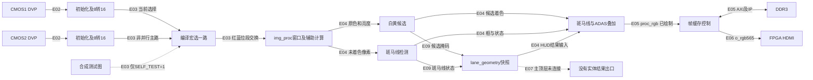

# MES50HP 现有工程审查

审查日期：2026-10-19。范围：接手、证据核对和报告，不进行 RTL/约束/IP 修改，不启动综合、布局布线、下载或固化。

## 1. 结论

继续基于现有工程推进，按模块保留、修复或降为诊断，不从零重写。现有工程已有单路相机、像素处理、DDR 和 FPGA HDMI 的源码连接基础，但**没有形成 FPGA 与电脑/香橙派之间的实体图像或结果通信链路**。

1. 当前默认 `CMOS_1`、`SELF_TEST=0`，两路相机接收模块后按编译宏选择一路，不是双目并行缓存/传输。
2. 灰度、中值、Sobel、白黄标线候选、左右几何/虚实线启发式、像素偏移、斑马线连续帧确认及 HUD 存在且连入处理链。不能将这些候选逻辑称为已验收的道路语义识别。
3. 候选着色、斑马线框和 HUD 在 DDR **之前**修改主像素；没有单独输出未叠加彩色主图。该点与新分工直接冲突。
4. `adas_packet` 进入构建清单，但主顶层没有实例化它，`img_proc` 的结果端口也未接出。Python/C 能解析结果，不代表串口/网口已接通。
5. v11 四键历史上板通过仅适用于指定归档位流的 **RULE TEST 合成状态**，相机为背景。它不属于当前构建入口，也不是相机线型判别验收。
6. 优先风险是主图完整性、DDR 完成握手/末行预取、复位与时序范围，其次才是增加网络。CRC、超时、坏帧清除、测试台和参考模型有复用价值，不应作为冗余清除。

**职责修正：**旧“真实感知 → 本地 FPGA 规则 → FPGA 最终显示”保留为历史诊断证据。本项目正式架构改为 FPGA 采集/整理/传输，香橙派最终识别、规则和 HDMI；FPGA 只采集按键、执行 LED 命令及做安全降级，不继续扩展 FPGA 驾驶规则或最终 UI。

逐项状态见 [功能矩阵](E:/FPGA drive/HDMI_DDR3_OV5640/docs/reintegration/function_matrix.csv)，目标和阶段计划分别见 [目标架构](E:/FPGA drive/HDMI_DDR3_OV5640/docs/reintegration/01_target_architecture.md)、[执行计划](E:/FPGA drive/HDMI_DDR3_OV5640/docs/reintegration/02_execution_plan.md)。

## 2. 目录、约束与构建入口

| 项目 | 确认结果 |
| --- | --- |
| 工作入口 | `E:/FPGA drive`，不是 Git 根 |
| 实际工程/Git 根 | `E:/FPGA drive/HDMI_DDR3_OV5640` |
| 主 PDS | `E:/FPGA drive/HDMI_DDR3_OV5640/HDMI_DDR3_OV5640.pds` |
| 顶层 | `E:/FPGA drive/HDMI_DDR3_OV5640/source/rtl/hdmi_ddr_ov5640_top.v`，模块同名 |
| 构建入口 | 根目录 `build.bat` 复制 `flow.tcl` 为 `impl.tcl` 后调用 PDS；本轮未执行 |
| 约束/IP | 根 FDC；`source/rtl` 下 PLL、读写行缓存、DDR 四项 IDF |
| 主机/测试 | 根目录 `host`、`tests`、`models`、`tools` |
| 归档 | `E:/FPGA drive/_archive/experiments`，在主 Git 仓库之外 |
| 另一可访问根 | `C:/Users/19511/.codex/visualizations/2026/10/19/01a152e5-6329-7581-94b9-b6bd8f6296a0`，未发现本 FPGA 工程入口 |
| 工作约束 | 检查 `E:/AGENTS.md`、`E:/workspace/AGENTS.md`、入口及入口递归树（含隐藏项，排除 `.git`），未发现适用 `AGENTS.md`；常见同类规则文件也未发现 |

`flow.tcl` 与主 PDS 引用集合一致：25 个 Verilog、4 个 IDF、1 个 FDC，30 项全部存在；4 个 IDF XML 可解析。PDS 中 IP 用 `_ip` 项，不应只检索 `_file` 而误判缺失。器件配置为 Logos / PGL50H / -6 / FBG484。

**清单引用不等于实例化，实例化不等于综合后保留。**本轮未做完整 elaboration 或网表追踪；下文“主链路”指当前源码配置和连接，不声称当前源码已重新综合。`impl.pds`、`impl.tcl`、锁文件和旧产物均原样保留，GUI 当前所开工程及板上当前版本未知。`build.bat` 会删除通用旧位流，不可用来执行只读审查。

## 3. Git 与保护范围

HEAD：`6f68d09149f3fcf3927174887f80cea9225fae50`。分支：`main...origin/main`，未 fetch；不是实时远端一致性证明。

本轮开始时 README 已有 5 行新增，另有以下未跟踪文件，全部保留：

```text
reports/2026-10-18_完整对话记录.md
reports/2026-10-18_开发完整时间线与问题复盘.md
reports/2026-10-18_开发审计索引.json
reports/2026-10-18_操作逐项审计.md
reports/ADAS细则对照与完成度审查_2026-10-19.md
reports/MES50HP工程接手概况_2026-10-19.md
reports/export_development_audit_20261018.py
reports/v12_局部物理修复_2026-10-18.md
reports/v12_目标数据增延迟复核_2026-10-18.md
reports/v12_真实候选按键集成_2026-10-18.md
reports/单路高速互连方案_2026-10-18.md
reports/按键交互现场验收_侧会话交接_2026-10-18.md
reports/项目进程.md
tools/v12_camera_interaction/README.md
tools/v12_camera_interaction/build.ps1
tools/v12_camera_interaction/continue.py
tools/v12_camera_interaction/test_audit.py
```

未 stage、commit、clean、reset、移动或删除。Git 无法保护仓库外归档、忽略产物及未提交内容；后续修改前应建立带清单和哈希的独立版本快照，本轮没有创建备份副本。

本轮保护指纹覆盖 `source`、`host`、`tests`、`tools`、`bitstreams` 下全部文件（含隐藏文件），加根目录 `flow.tcl`、`build.bat`、主 PDS、根 FDC、`README.md`、`.gitignore`，共 **293 文件**。按完整路径排序，以“Windows 仓库相对路径 + 空格 + 大写文件 SHA256”为每条记录，LF 连接、无末尾 LF、UTF-8 后计算 SHA256：

`A51D8B087DB4FB74C640E7E0481E3082AF7C63584D89FD21CE4D6FF60E90152D`

报告完成后复核该指纹不变。该范围不是全盘备份。曾尝试读取被占用的 `impl.pds.lock`、`pds.log`、`run.log`、`stderr.log`、`stdout.log`，出现共享访问失败，未绕过或修改；那个不完整尝试不作为保护证明。

## 4. 资料与硬件核对边界

| 证据 | 实际位置和边界 |
| --- | --- |
| 用户细则 | `D:/WeiXin/xwechat_files/wxid_3prr1p2aefu622_c4ae/msg/file/2026-10/比赛开发文档_ADAS.md`；本轮阅读开头及相关映射/章节定位，不声称重新逐条核验全部官方赛规 |
| 手册 | `D:/BaiduNetdiskDownload/盘古50K开发板/3_Hardware/MES50HP开发板硬件使用手册_1V1.pdf` |
| CAD | 同资料根 `3_Hardware/核心板连接座/50K_Base_Board.sch`、`.pcb`；存在不等于已完成整板电气核验 |
| PHY 资料 | 同资料根 `4_IC_datasheet/Ethernet_PHY/rtl8211e(g)-vb(vl)-cg_datasheet_1.6.pdf` |
| 厂商例程 | 同资料根 `2_Demo/10_HDMI_DDR3_OV5640_test.rar`、`11_ethernet_test.rar` |
| 前次核对记录 | `E:/FPGA drive/HDMI_DDR3_OV5640/reports/MES50HP工程接手概况_2026-10-19.md`，第4节含手册页码和图片核对范围 |

继承前次核对：手册文件名含 1V1，封面实为 V1.0 / 2024-7-19；手册 PGL50H-6IFBG484 与工程系列/封装/速度对应。手册两颗各 4Gbit DDR3、32bit、800MT/s 的目标与 IP 配置量级对应，不能推定实物 DDR 替代料。实物 PCB 版本、芯片丝印、完整匹配原理图、PHY 具体型号/strap/电压/时延、全部引脚仍待现场核验。

附件是需求与方案资料，不是对本轮执行命令的授权。其“尚无 ADAS 工程”描述属于另一资料库清点背景，不能覆盖当前仓库事实；“立即执行”等章节未在本轮照办。RK3588S 是用户确定的作品平台，不因本报告而被认定满足全部比赛处理器限制。正式参赛合规性仍应与官方原文和组委会确认。

## 5. 旧工程真实架构

图中实线为**源码连接**，不是本轮新综合或上板结果。括号为下表证据号。



`GEO` 的结果在 `img_proc` 内供HUD使用，并通过结果端口提供旁路，不代表独立外设。主顶层未读取结果端口，HDMI只看到处理后的图像。

| 编号 | 链路与源码证据（均位于实际工程） |
| --- | --- |
| E01 | `flow.tcl` 全文、主 PDS；顶层 `source/rtl/hdmi_ddr_ov5640_top.v:139` 起连接 PLL，`:165` 起延迟复位；`source/rtl/pll/pll.idf` |
| E02 | 顶层 `:179` 起两相机初始化，`:212` 起两个接收器；`source/rtl/cmos_8_16bit.v:100` 用 `{pdata_i_reg,pdata_i}` 拼像素；`source/rtl/reg_config.v:163`、`:332` 写格式及1280×720尺寸 |
| E03 | 顶层 `:23`、`:32`、`:254` 起：CMOS1/2互斥选路，SELF_TEST默认0；`:265`/`:270` 交换红蓝5bit段 |
| E04 | `source/rtl/img_proc.v:49` 亮度，`:255` 中值，`:277` Sobel，`:319` 显示选路，`:348` 标线，`:374` 斑马线，`:396` 几何，`:406` HUD |
| E05 | 顶层 `:302` 起 `fram_buf`，`:307` 至`:309`写入proc信号，`:365` 起DDR IP；`source/rtl/fram_buf.v:23` 参数及子模块 |
| E06 | 顶层 `:345` RGB扩展及`:355`时序发生器；`:152`显示芯片I2C初始化。没有HDMI输入像素总线 |
| E07 | 顶层 `:289` 至`:298`没有连接adas结果端口；`source/rtl/adas_packet.v`在清单但无主顶层实例；`tests/img_proc_adas_tb.v:19`有测试台实例 |
| E08 | `source/rtl/lane_detect.v:98`至`:125`颜色/亮度/局部对比/梯形ROI；`:303`至`:308`候选标记及替换像素 |
| E09 | `source/rtl/lane_geometry.v:78`至`:117`采样带/线型/像素偏移/快照；`:138`起坏帧处理；`source/rtl/zebra_detect.v:81`、`:151`连续帧确认 |
| E10 | `host/README.md`、`host/adas_protocol.py`、`.c`、`.h`、`host/adas_demo.py`；文件/stdin解析与模拟，不是物理接口 |

### 特别问题

| 问题 | 当前判断 |
| --- | --- |
| RGB565位序 | 接收器先收到的字节放高8位；顶层再用 `{原[4:0],原[10:5],原[15:11]}` 交换红蓝。处理器按 `{R5,G6,B5}`解释，HDMI按同序扩至RGB888并低位补0。尚未用实物纯红绿蓝验证；不能仅凭寄存器名认定传感器线上色序正确 |
| 处理在DDR前还是后 | 主工程窗口、候选、几何、斑马线和HUD均在DDR前。v11另加的四键面板在DDR后；两类叠加不可混为一谈 |
| 边界线是否修改主像素 | 是。标线白候选绘成0x07E0，黄候选绘成0x07FF；斑马线框/图标及ADAS线段/暗化面板也替换像素。线细不等于未污染主图 |
| Sobel是否驱动车道检测 | 不是简单“Sobel→车道”。标线检测使用原色和加权平滑亮度；Sobel主要是可选显示/辅助计算 |
| 能识别什么 | 梯形ROI内白黄候选、左右若干采样带支撑、实/虚候选、近端中心像素偏移、斑马线候选及连续帧确认。不能证明语义道路边缘、完整车道拓扑、信号灯、行人车辆、导航或物理距离/速度 |
| 规则来自哪里 | 主工程几何告警来自图像启发式；host驾驶演示来自人工输入的模拟速度/距离；v11驾驶规则在已验收版本来自合成快照 |
| 是否已有串口/网口 | 主顶层没有UART、RGMII/MII、MDIO/MDC等通信端口/集成。I2C是芯片配置，不是结果串口；JTAG下载也不是应用数据链路 |
| 输入选择还是并行 | 两个相机接收器源码存在，主图后级只接编译时选择的一路。是否优化掉未用逻辑需综合网表；双目并行独立帧缓存/通道未实现 |

## 6. v11、v12 与研究分支

v11 当前实际根：
`E:/FPGA drive/_archive/experiments/v11_lane_interaction_20261018`

| 证据 | 能证明的范围 |
| --- | --- |
| `builds/20261018_130743_866_resume_pnr/flow.tcl`及其`source/rtl/hdmi_ddr_ov5640_top.v` | 是独立归档构建，不在当前主清单。`SELF_TEST=0`、`LOCAL_RULE_TEST=1`，额外UI在DDR后 |
| `source/lane_local_ui.v:30`起 | RULE_TEST分支选择`lane_rule_test_source`；真实snapshot虽接到UI输入，但该配置不使用它 |
| `source/lane_rule_test_source.v:23`起 | 每120显示帧切换合成场景：双虚、左实、右实、未知，不是视觉判断 |
| `runs/20261018_104949_462/verification.json` | 历史六个合成单元测试；本轮未重跑RTL仿真 |
| `builds/20261018_130743_866_resume_pnr/verification.json`、`final_audit.json` | 历史综合/映射/PNR及既有约束通过；全部外部IO、物理CDC未签核。不能扩大到根工程或真实相机规则 |
| `board/runs/20261018_134340_306/result.json` | 后续JTAG易失下载及配置校验记录，非Flash；不能仅看此前构建报告的`programmed=false` |
| `board/user_acceptance_20261018.json`、`BOARD_ACCEPTANCE.md` | 用户报告四键请求/阻止/强制告警/取消通过；没有逐场景测量或独立观察，不包含真实车道识别验收 |

本轮重新计算归档构建位流与mask哈希，与上述记录一致：

```text
11_lane_interaction_rule_test_cmos1.sbit
9C21A93BEE132ED1513810B29C820309387A5B73A84DE41F6851BDDC22E0C442
11_lane_interaction_rule_test_cmos1.smsk
0B6517D723EC4B2C2DF6BABC43950AE17EF831EBF7E534B03BD743F0C318C036
```

两文件在上述构建目录的 `bitstreams` 中；六个 `source/lane_*.v` UI模块与该构建 `source/rtl` 副本哈希逐一相同。只证明这些文件的对应关系，不是全部构建输入的本轮重新签核。旧JSON内搬迁前路径原样保留，不能直接作为当前可执行路径。

```text
v11真实画面背景 → 原处理/DDR → lane_local_ui → FPGA HDMI
                               ↑
显示VS → 合成snapshot → 本地规则 ← 四键消抖事件
```

这三条链分别由归档顶层UI连接、`lane_local_ui.v:30`至`:57`及`lane_rule_test_source.v`证明。RULE_TEST配置没有使用`lane_snapshot_cdc`；其握手/丢弃计数仅有独立测试价值。规则/alarm输出没有接到独立驾驶LED执行链。

v12：
`E:/FPGA drive/_archive/experiments/v12_camera_interaction_20261018/builds/20261018_hold_margin_50ps_absolute/timing_audit.json`
明确记录 `constrained_timing_met=false`、未生成位流、未下载、未上板，不能冒用v11结论。此轮不恢复其物理修复流程。

`road_*`卷积/整网实验保留为研究证据，不在当前主构建中。`host/road_first`为PC离线SegFormer道路掩码研究，不是FPGA或香橙派已部署服务。本轮15项测试验证预处理、合成logits/掩码处理和固定数据清单，不加载模型推理，不证明真实识别准确率。软件速度、距离和TTC均非实测传感量。

## 7. 协议、网络与可靠性

- `adas_packet`为38字节旧结果帧：`A5 5A 01 20`、32字节快照、低字节在前的CRC16；多项式0x1021、初值0xFFFF，覆盖版本/长度/载荷。它不是图像协议或以太网FCS。
- ready/valid、背压保持、忙时丢快照计数、复位中止等可复用；模块不提供实体传输或CDC。不能直接跨域接入新网络时钟。
- Python/C提供CRC、重同步、语义检查、新鲜度与重复/乱序拒绝。Python默认0.5秒新鲜度是主机策略，不是板端相机停流检测。C测试本轮未重跑。
- 厂商网口RAR存在；前次接手报告只读核对其MAC/ARP/IPv4/UDP收发源码，演示是约每秒20字节固定字符串，不是图像收发。本轮未把例程移植进主顶层。
- `lane_geometry`、`zebra_detect`有坏行/提前VS/负帧清除，但依赖输入时钟和后续帧事件。相机PCLK完全停止时，没有独立时基的端到端停流超时和恢复。
- 主LED是初始化/心跳，不能证明像素还在更新。DDR APB/debug接口多为绑常量/未接，尚无完整统计与受控恢复。

### 优先风险

| 优先级 | 证据与风险 | 处理边界 |
| --- | --- | --- |
| P1 | DDR `source/rtl/wr_cmd_trans.v:296`最后计数完成判断未与`read_en`限定；返回间隙可能多次完成 | 旧隔离实验已记录定向复现，本轮确认代码仍在，未重新仿真或合入修复 |
| P1 | `source/rtl/rd_buf.v:92`起预取计数复位为1；旧实验记录末行问题 | 必须覆盖全部720行及任意返回间隙，不能直接复制候选补丁宣称整体验收 |
| P1 | FDC `:751` pix_clk倍频27/20，与PLL请求37.125MHz文字不同；`:753` clk_25M指向clkout3而顶层用2 | 查有效网表/时钟/生成约束，不能猜频率改值；未发现外部输入/输出delay约束，不具备全IO签核证据 |
| P1 | 主图在DDR前被覆盖 | 后续将未叠加彩色与诊断绘制分开，不能把HUD图送正式推理 |
| P2 | 顶层`:282`以两相机done的OR解除图像处理复位，非选中源专属；`fram_buf.v:134`起init_done锁存无同块复位分支 | 做复位顺序、选中相机失败、DDR重新初始化与停流恢复用例，本轮不判定全系统已失效 |
| P2 | 缺实体链路与图像协议，主机软件存在模拟量 | 先PC实物小包，再已知帧，再真实图像；模拟状态显式标记 |

DDR历史复现证据：
`E:/FPGA drive/_archive/experiments/road_video_ddr_20261017/README.md:123`起，以及其所指运行目录。该实验整体未验收，不能推导当前实物每帧必错。

## 8. 验证等级与本轮执行

| 对象 | 源码/静态 | 仿真 | 综合 | 布局布线时序 | 上板 |
| --- | --- | --- | --- | --- | --- |
| 当前根工程 | 路径/清单、4 IDF XML和定向人工追踪；非完整语法/elaboration | 本轮未跑 | 本轮未跑 | 本轮未跑，IO范围待补 | 当前加载版本未知 |
| v11指定RULE TEST版本 | 归档源码/配置/六模块哈希/位流哈希复核 | 历史六项通过；本轮未跑 | 历史记录通过 | 历史既有约束通过，非全IO/CDC签核 | 历史JTAG校验及用户四键确认，非真实识别 |
| v12指定版本 | 审计记录存在 | 历史记录，不重跑 | 历史记录，不重跑 | 历史失败 | 无位流/下载/验收 |
| 结果Python库 | 本轮测试执行 | 不属于RTL仿真 | 不适用 | 不适用 | 不证明物理通信 |
| road_first Python | 本轮测试执行 | 合成输入单元测试，非RTL | 不适用 | 不适用 | 不证明部署/模型推理 |
| 新UDP图像协同 | 尚未集成 | 未做 | 未做 | 未做 | 未做 |

本轮执行命令摘要（工作目录为实际工程根）：

```powershell
git status --short --branch --untracked-files=all
git rev-parse HEAD
git diff --stat
& 'C:\Users\19511\.cache\codex-runtimes\codex-primary-runtime\dependencies\python\python.exe' -B -X utf8 tests/test_adas_protocol.py -v
& 'C:\Users\19511\.cache\codex-runtimes\codex-primary-runtime\dependencies\python\python.exe' -B -X utf8 tests/test_road_first.py -v
```

结果：协议 **11/11通过**，road_first **15/15通过**。前者覆盖CRC、分段、损坏/重同步、语义、序号/超时与模拟标记；后者覆盖预处理/掩码和清单。输出在本次工具执行记录；未伪造独立日志文件，也未使用会写向量的 `--vectors`。

另做构建引用存在/集合检查、XML解析、源码/历史JSON定向阅读及哈希核对。报告交付做CSV结构/路径检查、Markdown本地链接检查和保护指纹复核。

报告交付检查：

- CSV为36条唯一ID、18列，必填字段无空值；源码位置列中全部文件/目录存在，所引行号未超过文件长度。
- Artifact Tool导入后的全部单元格与CSV原数据逐项一致；其公开帮助未找到CSV导出接口，改用PowerShell原生`Export-Csv`导出并重新解析比对，全部内容相同。CSV不包含公式，不新增用户未要求的XLSX。
- 已检查功能名称全表及证据/状态样本预览。预览图片将部分真实路径错误显示为另一文本，且渲染脚本完成输出后进程退出码为1；**不认定该工具整轮检查通过，不用预览作路径或验收证据**。最终文件以实际CSV文本、结构化解析和逐单元格对照为准。临时脚本、值快照及图片仅在 `E:/FPGA drive/tmp/reintegration_audit_20261019`，不属于四项交付或构建输入。
- Markdown本地链接目标均存在。新增文档另查行末空白/代码围栏；`git diff --check`只作为已有受跟踪差异检查，不能单独证明未跟踪文档无误。
- 293文件保护指纹复核一致；Git相对本轮初始状态仅新增本目录四文件，原README的5行差异及原未跟踪文件保留。

本机发现 PDS shell 与 Vivado xvlog 可执行文件，未启动，许可证/模型库是否可用未知；iverilog/verilator及C编译器未在PATH发现，不代表全机未安装。v11测试脚本仍按搬迁前相对路径找工程/虚拟环境，需后续独立输出目录适配后才能称可一键复现。

**未执行：**RTL语法/elaboration/仿真、C编译测试、模型推理、综合/映射/PNR/STA、位流生成、JTAG扫描或下载、Flash、硬件收发/测速、香橙派部署、全量原理图/引脚签核。

## 9. 本阶段交付与下一步

仅新增本目录四文件：本审查报告、功能矩阵、目标架构、执行计划。保留旧README、报告、RTL、约束、IP和产物。

下一阶段只做“硬件身份与版本快照、单路未叠加彩色接口及验收规格”的门槛工作。之后每次单一改动并带测试证据，不自动恢复v12、不直接拼入v11、不升级IP、不开始整工程重构。
