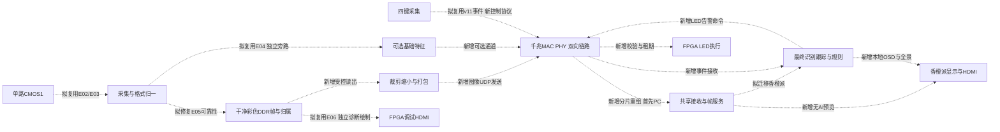

# FPGA 与香橙派目标架构

日期：2026-10-19。性质：待实现设计，不是已集成或已上板架构。当前事实及证据见 [工程审查](E:/FPGA drive/HDMI_DDR3_OV5640/docs/reintegration/00_project_audit.md)。

## 1. 职责边界

| 功能 | FPGA | PC测试端 / 最终香橙派 |
| --- | --- | --- |
| 视频入口 | 相机DVP；后续HDMI像素接收、网络像素接收 | 提供测试文件解码像素，不冒充板端采集 |
| 图像通路 | 格式统一、DDR、帧边界、裁剪缩小；可选灰度/滤波/Sobel/颜色阈值 | 接收/重组/保存和统一预览；模型预处理与推理 |
| 最终识别 | 不承担道路语义与驾驶安全判定 | 车道/虚实线、斑马线、道路边缘、信号灯、行人车辆、跟踪 |
| 规则 | 按键采集、命令校验、LED执行和失联降级 | 多帧关联、驾驶意图、规则和告警决策 |
| 显示 | 可选板级调试HDMI，诊断绘制不写回彩色主图 | 无AI叠加预览与识别视图共享接收服务；最终HDMI/UI |
| 可靠性 | 行帧统计、溢出/欠载、DDR/输入/网络状态、受控恢复 | 会话/帧重组、超时、丢包统计、服务恢复、端到端记录 |

PC先完成接收与故障测试，随后迁移香橙派5 16GB/RK3588S；两者部署状态和性能分别验收。不会因为PC演示通过就认定香橙派已完成。

旧建议“真实感知 → FPGA本地驾驶规则 → FPGA最终显示”仅作为诊断与回归对照。v11消抖/事件、超时、CDC和测试方法可按模块复用，但合成规则源和FPGA最终规则/显示不继续扩展到正式主线。也不将检测框回传FPGA作为必要功能。

## 2. 目标数据流

以下箭头**全部为规划连接，尚未完成目标集成**。标注的旧模块只是复用起点；没有源码起点的功能明确为新增缺口。

E02至E06对应审查报告第5节，证明旧源码起点，不证明目标箭头已接通。v11参考位于 `E:/FPGA drive/_archive/experiments/v11_lane_interaction_20261018/source`。UDP、共享接收服务、正式命令执行等目标连接目前没有主工程实现证据。

### 彩色主图约定

1. 明确定义入口RGB565位段、两字节在线上/内存/网络中的顺序、宽高、行步长、有效区域和帧号。RGB565位序与字节端序是两个独立问题，均用纯色与编号图测试。
2. DDR发布和网络发送所用彩色帧不得含候选线、HUD、状态面板或其他人工标记。可选特征独立输出或显式复用计算，不覆盖主图。
3. 调试HDMI读取彩色帧后叠加，禁止反馈写回主缓冲；关闭特征/诊断后仍需证明主图逐像素一致。不能仅将MODE设为0就声称所有overlay和计算均被关闭。
4. 帧缓冲归属、完整帧发布、异常丢弃和多时钟域握手先定义再实现。网络阻塞不得令相机半帧覆盖一张已发布帧。
5. 首版不并入 `road_*` 神经网络加速器；不为复用研究代码而改变主架构。

## 3. 通信分层与待定协议

| 层级 | 可参考证据 | 仍需新增/验收 |
| --- | --- | --- |
| PHY/RGMII | 本地RTL8211E资料、厂商 `11_ethernet_test.rar` | 对应实物的引脚/电压/strap/延时/复位、协商、收发IO约束和签核 |
| MAC/ARP/IPv4/UDP | 厂商小包TX/RX源码 | 集成、边界/校验、双向PC抓包及重启恢复；不是直接假定已有视频能力 |
| 图像应用层 | 当前无主工程集成 | 帧/分片/通道身份、完整性、重组超时、乱序/重复、限长和速率控制 |
| 控制应用层 | v11事件机制、旧协议CRC/序号/新鲜度思想 | 新按键事件和LED命令语义、确认/幂等/租期，不能把旧32字节识别快照当新控制协议 |

建议的待定字段：协议版本/消息类型、设备身份、启动会话、通道、源帧号、采集时间戳及其时基、宽高/格式/步长、有效载荷长度、分片序号/数量/偏移、总帧长度、应用完整性校验。字段宽度、端序、MTU及校验范围在协议阶段冻结，本轮不擅自指定兼容版本或网络地址。

- UDP只是承载，不提供整帧可靠性。丢失/超时/非法重叠分片不拼成“正常新帧”；队列有界，过载优先丢弃完整旧帧并计数。
- 区分相机停流、DDR异常、PHY断链、主机丢包、推理过期。相机停止需由不依赖PCLK的时基观察。
- 初始阶段先验证控制收发和已知测试帧；再接真实彩色主图。反向LED命令失联后进入约定状态，而不是沿用上次驾驶许可。
- 按键携带事件序号/会话/时间，不只发瞬时电平。ARM负责解释请求；命令执行需防重复、过期和越界。
- 旧 `adas_packet`/Python/C作为历史结果回放与诊断保留。CRC16不能替代链路FCS，主机新鲜度不能替代板端watchdog。
- 不默认PCIe DMA可用，也不为本阶段引入PCIe或第二块FPGA。

## 4. 带宽预算示例

下列为**未压缩RGB565有效像素的算术预算**，不含包头、间隔、特征流、控制、DDR读写和主机开销，也不是实测吞吐：

| 场景 | 计算 | 有效载荷速率 |
| --- | --- | --- |
| 单路1280×720、30fps | 1280×720×2×30 | 55,296,000 B/s，442.368 Mb/s |
| 双路同规格 | 上项×2 | 110,592,000 B/s，884.736 Mb/s，千兆下余量很小 |
| 四路640×360、15fps | 640×360×2×15×4 | 27,648,000 B/s，221.184 Mb/s |
| 网络第四路输入再上传 | 同一图像增加一次接收处理及发送 | 分别核算每方向链路及DDR总负载，不能只算显示帧率 |

因此先保留彩色再裁剪/缩小/限速，尺寸和帧率以实测链路余量确定。示例不是承诺首版720p30或四路目标一定可达。双目分路同步、曝光时间和几何标定也不能由平均FPS推导。

## 5. 扩展顺序与验收身份

| 阶段 | 新增来源 | 必须证明 |
| --- | --- | --- |
| 单板单路 | CMOS1真实画面 | 源帧完整、干净彩色、PC收帧、失联可恢复 |
| 双目并行 | CMOS2独立通道 | 不再是宏选路；每路CDC/缓存/帧号/统计独立，两路同时动态输入 |
| 相机加HDMI | 对应实物HDMI RX像素入口 | 仅I2C初始化不算接入；先证明独立源和格式转换 |
| 网络第四路 | 外部解码像素经网络送FPGA | 在FPGA内接收、缓存/处理，再上传；不能把主机本地四窗口当四路采集 |
| 全景/可选双板 | 条件满足后另评估 | 标定/时基/视场/接缝与四宫格分别验收；第二板不是默认 |

U盘文件场景后续由PC/香橙派解码，通过受控输入链送FPGA后再回接收服务，以证明FPGA参与。它与板载相机单路基线分别记录，不在本轮追加实现。

## 6. 目标完成证据

每阶段绑定Git/脏文件快照、源码/IP/约束清单与哈希、工具版本、配置、测试输入和输出、实际命令/退出码、时序范围、位流哈希、实物连接、PC/香橙派软件版本及现场结果。没有工具或硬件时保留未验证项，不将某层通过写成整个系统完成。
